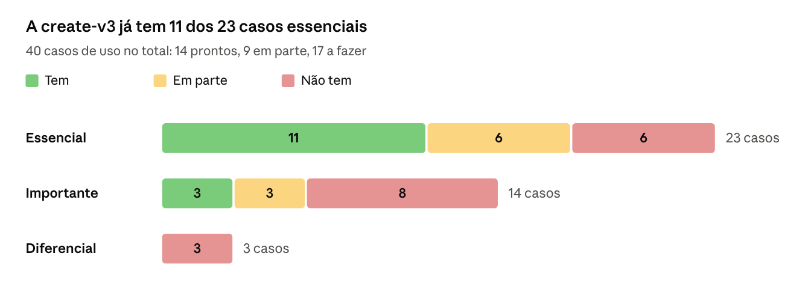
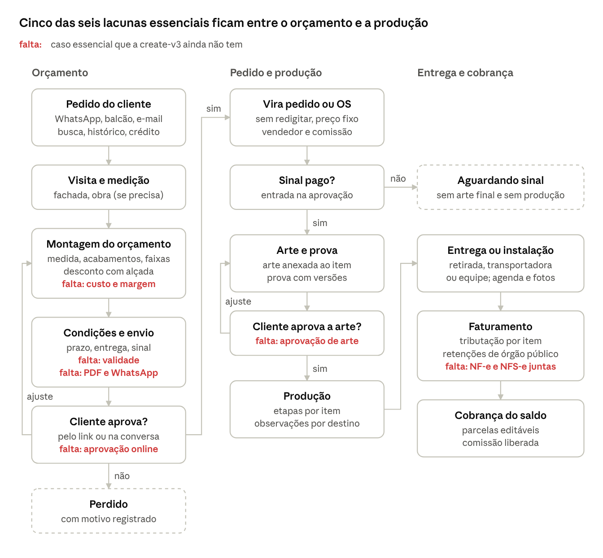

# A create-v3 já orça; falta o cliente aprovar

**Data:** 2026-10-20 · **Autor:** Claude Code [L+C], a pedido do Luiz · **Tela:** [/sells/create-v3](../../../resources/js/Pages/Sells/CreateV3.charter.md)
**Escopo:** que casos de uso a tela Nova venda deve ter, olhando 27 concorrentes (13 de comunicação visual no Brasil). Só material público: site, central de ajuda e notícias. Nada foi testado.

> Parte do pacote [Protótipo create-v3](README.md). Notas de pesquisa em [notas/casos-de-uso/](notas/casos-de-uso/).

A tela "Nova venda" de comunicação visual (CV) precisa cobrir **40 casos de uso**, do pedido que chega no WhatsApp até a cobrança do saldo. Desses, **23 são essenciais**, porque quase todo sistema do segmento oferece (Mubisys, Holdprint, VisualCalc, Nortgraf, GestãoClick, shopVOX). A create-v3 já tem **14 dos 40 e 11 dos 23 essenciais**, com destaque para item por medida, desconto com alçada, parcelas, comissão e situação da venda com papéis. Cinco das seis lacunas essenciais ficam entre o orçamento e a produção: **composição com custo e margem, validade, PDF/WhatsApp, aprovação online do orçamento e aprovação de arte**. A sexta, **NF-e + NFS-e da mesma venda**, fica no faturamento.

## Casos de uso por etapa da venda

Referência: protótipo /sells/create-v3 em 20/10/2026, que ainda não grava dados.

Prioridade: **Essencial** = quase todo sistema de CV tem, ou a venda de CV trava sem ele. **Importante** = vários têm e há dor citada. **Diferencial** = poucos têm. "Quem já oferece" lista só o que achamos em fonte pública. Se um sistema não aparece, não quer dizer que ele não tenha.

### Cliente

| Caso de uso | O que é | Quem já oferece | Prioridade | create-v3 hoje |
|---|---|---|---|---|
| Busca e cadastro rápido de cliente | Achar o cliente por nome, código, CPF/CNPJ ou telefone e cadastrá-lo sem sair da venda. | [Bling](https://ajuda.bling.com.br/hc/pt-br/articles/360036358474-Inserir-um-pedido-de-venda), [Olist](https://ajuda.olist.com/pedidos/pedidos-de-venda-como-utilizar) (busca por telefone), [Omie](https://ajuda.omie.com.br/pt-BR/articles/498865-cadastrando-um-novo-pedido-de-venda), [Conta Azul](https://ajuda.contaazul.com/hc/pt-br/articles/7407294646157-Or%C3%A7amentos-como-criar), [Sankhya](https://ajuda.sankhya.com.br/hc/pt-br/articles/7095174740119-Cadastro-r%C3%A1pido-de-parceiro-na-Central-de-Vendas-e-no-novo-PDV-WEB) | Essencial | **Tem** (sem busca por telefone) |
| Venda rápida de balcão | Cliente "Consumidor final" e poucos campos para serviço feito na hora. | [Ajors SIGN](https://ajors.com.br/ajors-sign), [Zênite](https://www.zsl.com.br/), [Holdprint](https://www.holdprint.net/) (PDV), [GestãoClick](https://gestaoclick.com.br/segmentos/programa-para-empresa-de-comunicacao-visual/) (PDV com m²), [Olist](https://tiny.com.br/api-docs/api2-pedidos-incluir) (consumidor final com CPF opcional) | Essencial | **Tem** |
| Histórico do cliente e recompra | Ver as últimas vendas e os preços do cliente e duplicar uma venda anterior. | [Bling](https://ajuda.bling.com.br/hc/pt-br/articles/360036358474-Inserir-um-pedido-de-venda) (últimas vendas; [clonar](https://ajuda.bling.com.br/hc/pt-br/articles/360040976893-Clonar-um-pedido-de-venda)), [Omie](https://ajuda.omie.com.br/pt-BR/articles/498901-duplicando-um-pedido-de-venda), [Conta Azul](https://ajuda.contaazul.com/hc/pt-br/articles/7656679164557-Vendas-como-clonar), [shopVOX](https://shopvox-pro.helpdocs.io/article/avhotlqqzj-transactions-new-quote) (Create Copy), [Sign OS](https://signos.com.au/) (repetir job), [VisualCalc](https://www.visualcalc.com.br/) (histórico do cliente) | Importante | **Não tem** |
| Crédito e inadimplência do cliente | Avisar ou bloquear cliente em atraso e usar crédito ou adiantamento como pagamento. | [Conta Azul](https://ajuda.contaazul.com/hc/pt-br/articles/45685486773645-Vendas-como-preencher-o-bloco-Informa%C3%A7%C3%B5es-da-venda) (alerta "Cliente inadimplente"), [Olist](https://ajuda.olist.com/pedidos/pedidos-de-venda-configuracoes) (bloqueio por atraso), [Calcgraf](https://www.calcgraf.com.br/solucao/orcamento/) (restrição de crédito), [Holdprint](https://www.holdprint.net/) (créditos e permutas), [Nortgraf](https://nortgraf.com/ajuda/artigo/creditos-de-cliente) | Importante | **Não tem** (o aviso é da tela; o saldo virá do financeiro) |

### Itens e preço

| Caso de uso | O que é | Quem já oferece | Prioridade | create-v3 hoje |
|---|---|---|---|---|
| Item por medida | Largura × altura × peças vira m², metro linear ou peça, com preço calculado. | [GestãoClick](https://gestaoclick.com.br/segmentos/programa-para-empresa-de-comunicacao-visual/), [Nortgraf](https://nortgraf.com/comunicacao-visual), [VisualCalc](https://www.visualcalc.com.br/), [shopVOX](https://shopvox-pro.helpdocs.io/article/t6cpucl51f-products-pricing-type-formulas), [Sign OS](https://signos.com.au/), [Cyrious](https://control.cyriouswiki.com/pricing_ch_02-cyrious_and_pricing) | Essencial | **Tem** (m², m³, metro linear e qtd direta) |
| Busca de item e item avulso | Achar produto por nome, SKU ou código de barras, ou lançar um item sem cadastro. | [Omie](https://ajuda.omie.com.br/pt-BR/articles/6882367-incluindo-um-novo-item-no-pedido-de-venda) (código e EAN), [Olist](https://ajuda.olist.com/pedidos/pedidos-de-venda-configuracoes) (produto não cadastrado), [Nortgraf](https://nortgraf.com/ajuda/artigo/orcamentos-do-rascunho-a-conversao-em-pedido) (item avulso), [shopVOX](https://shopvox-pro.helpdocs.io/article/q3j7kil5u1-how-to-create-a-quote) (item custom), [Sign OS](https://signos.com.au/) (one-off) | Essencial | **Em parte** (busca tem; item avulso não) |
| Produto e serviço na mesma venda | Placa, arte e instalação no mesmo pedido, com subtotal de produtos e de serviços. | [GestãoClick](https://gestaoclick.com.br/segmentos/programa-para-empresa-de-comunicacao-visual/) (subtotais separados), [Nortgraf](https://nortgraf.com/ajuda/artigo/emitindo-nf-e-e-nfs-e-direto-da-pagina-do-pedido), [shopVOX](https://shopvox-pro.helpdocs.io/article/drj750nl5s-field-installation-golden-product) (instalação como item em horas) | Essencial | **Em parte** (serviço com funcionário e comissão; sem subtotais separados) |
| Composição com custo e margem | Item montado com material, máquina, mão de obra e acabamento; custo e margem à vista de quem pode ver. | [Mubisys](https://www.mubisys.com/comercial) (custeio direto), [Holdprint](https://www.holdprint.net/) (RKW), [VisualCalc](https://www.visualcalc.com.br/), [Nortgraf](https://nortgraf.com/comunicacao-visual), [shopVOX](https://shopvox-pro.helpdocs.io/article/umk75fccmv-pricing-methods-standard-product-and-cost-plus-pricing), [Ordant](https://www.ordant.com/module/best-print-estimating-software/) (margem-alvo), [Sign OS](https://signos.com.au/) (alerta de margem por IA) | Essencial | **Não tem** (margem só como base da comissão) |
| Desconto com alçada | Desconto por item e no pedido, em % ou R$; passou do limite, pede aprovação. | [Omie](https://ajuda.omie.com.br/pt-BR/articles/3469490-definindo-desconto-sobre-o-valor-total-do-pedido-de-venda) (% ou R$, rateado nos itens), [Bling](https://ajuda.bling.com.br/hc/pt-br/articles/360039700954-Como-ativar-e-usar-a-fun%C3%A7%C3%A3o-de-an%C3%A1lise-de-aprova%C3%A7%C3%A3o-de-desconto), [Olist](https://ajuda.olist.com/pedidos/pedidos-de-venda-como-utilizar) (senha de gerente), [Protheus](https://centraldeatendimento.totvs.com/hc/pt-br/articles/28002002857495-Cross-Segmentos-Backoffice-Protheus-SIGAFAT-Limite-de-desconto-no-pedido-de-venda-MATA410), [Sign OS](https://signos.com.au/) (aprovação antes do envio) | Essencial | **Tem** |
| Tabela de preço por cliente | O preço muda pelo grupo do cliente (balcão, revenda, governo). | [Nortgraf](https://nortgraf.com/ajuda/artigo/grupos-de-clientes-descontos-por-perfil-de-cliente), [shopVOX](https://shopvox-pro.helpdocs.io/article/41el5yiek9-understanding-pricing-levels-in-shop-vox), [CoreBridge](https://www.irga.com/cyrious-report/) (8 níveis, 2021), [Bling](https://ajuda.bling.com.br/hc/pt-br/articles/360054015753-Como-utilizar-a-lista-de-pre%C3%A7os-nas-vendas-do-Bling), [Conta Azul](https://ajuda.contaazul.com/hc/pt-br/articles/45847596868749-Tabela-de-pre%C3%A7os-como-usar-em-uma-venda-avulsa) | Importante | **Tem** |
| Faixas de preço e preço mínimo | O preço do m² cai com o volume; trabalho pequeno paga o mínimo. | [Nortgraf](https://nortgraf.com/ajuda/artigo/produtos-por-medida-faixas-de-metragem), [Sign OS](https://signos.com.au/), [shopVOX](https://shopvox-pro.helpdocs.io/article/ypey7v4668-sending-quotes-with-multiple-quanitites-on-a-line-item), [Cyrious](https://control.cyriouswiki.com/pricing_ch_02-cyrious_and_pricing), [EstiMate](https://estimatesoftware.com/features) | Importante | **Não tem** |
| Acabamentos como modificadores | Ilhós, bainha, dupla face e laminação somam ao preço como opções do item. | [shopVOX](https://shopvox-pro.helpdocs.io/article/xdnxvk5k50-understanding-modifiers-in-shop-vox-enhancing-product-pricing-flexibility), [CoreBridge](https://www.corebridge.net/estimating-intelligence), [Nortgraf](https://nortgraf.com/comunicacao-visual), [Sign OS](https://signos.com.au/) (regras de combinação) | Importante | **Não tem** (só acréscimo % genérico) |
| Estoque visível ao orçar | Mostrar o saldo do material ao lançar o item, sem baixar no orçamento. | [VisualCalc](https://www.visualcalc.com.br/), [Bling](https://ajuda.bling.com.br/hc/pt-br/articles/360036358474-Inserir-um-pedido-de-venda) (semáforo), [GestãoClick](https://gestaoclick.com.br/segmentos/programa-para-empresa-de-comunicacao-visual/), [Calcme](https://www.calcme.com.br/sistema-para-comunicacao-visual/) | Importante | **Tem** (avisa, não bloqueia) |
| Aproveitamento de mídia e chapa | Calcular a perda pela largura da bobina ou pela chapa inteira, não pela área líquida. | [Holdprint](https://www.holdprint.net/), [Mubisys](https://www.mubisys.com/comercial), [VisualCalc](https://www.visualcalc.com.br/) (simulador de bobina), [Calcgraf](https://www.calcgraf.com.br/solucao/orcamento/), [Sign OS](https://signos.com.au/) (nesting) | Diferencial | **Não tem** |

### Orçamento e aprovação

| Caso de uso | O que é | Quem já oferece | Prioridade | create-v3 hoje |
|---|---|---|---|---|
| Validade do orçamento | Data até quando o preço proposto vale. | [GestãoClick](https://gestaoclick.com.br/segmentos/programa-para-empresa-de-comunicacao-visual/), [Nortgraf](https://nortgraf.com/ajuda/artigo/orcamentos-do-rascunho-a-conversao-em-pedido), [Ordant](https://www.ordant.com/module/best-print-estimating-software/), [Conta Azul](https://ajuda.contaazul.com/hc/pt-br/articles/7407294646157-Or%C3%A7amentos-como-criar), [Bling](https://ajuda.bling.com.br/hc/pt-br/articles/360036981213-Inserir-uma-proposta-comercial) | Essencial | **Não tem** |
| Prazo de entrega e urgência | Data prometida ao cliente, digitada ou calculada, e marca de pedido urgente. | [GestãoClick](https://gestaoclick.com.br/segmentos/programa-para-empresa-de-comunicacao-visual/) (prazo e prioridade), [Holdprint](https://www.holdprint.net/) (data calculada), [Olist](https://ajuda.olist.com/pedidos/propostas-comerciais-inclusoes) (prazo por item), [Ordant](https://www.ordant.com/module/best-print-estimating-software/) (preço de urgência) | Essencial | **Em parte** (prazo da equipe e da etapa no item; sem data prometida no pedido) |
| PDF e envio por WhatsApp ou e-mail | Proposta em PDF, com ou sem valores, enviada com link pelo WhatsApp ou e-mail. | [VisualCalc](https://www.visualcalc.com.br/), [GestãoClick](https://gestaoclick.com.br/segmentos/programa-para-empresa-de-comunicacao-visual/), [Mubisys](https://www.mubisys.com/comercial), [Zênite](https://www.zsl.com.br/), [Bling](https://ajuda.bling.com.br/hc/pt-br/articles/1500007483382-Como-enviar-um-pedido-de-venda-para-meu-cliente), [Omie](https://ajuda.omie.com.br/pt-BR/articles/3623439-imprimindo-um-pedido-de-venda) (sem valores) | Essencial | **Não tem** |
| Aprovação online do orçamento | O cliente aprova, pede ajuste ou recusa por link, e o aceite fica registrado (no nível mais alto, assinatura com IP). | [VisualCalc](https://www.visualcalc.com.br/), [GestãoClick](https://gestaoclick.com.br/segmentos/programa-para-empresa-de-comunicacao-visual/) (assinatura com IP), [Nortgraf](https://nortgraf.com/comunicacao-visual), [Holdprint](https://www.holdprint.net/), [Ajors SIGN](https://ajors.com.br/ajors-sign), [shopVOX](https://shopvox-pro.helpdocs.io/article/l98d79i5hy-fri-01-24-2025-highlighted-feature-quote-review-and-online-approval-pro), [CoreBridge](https://www.corebridge.net/estimating-intelligence) (por linha) | Essencial | **Não tem** |
| Orçamento e pedido no mesmo registro | O orçamento aprovado vira pedido ou OS sem redigitar e com preço congelado. | [GestãoClick](https://gestaoclick.com.br/segmentos/programa-para-empresa-de-comunicacao-visual/), [VisualCalc](https://www.visualcalc.com.br/), [Ajors SIGN](https://ajors.com.br/ajors-sign), [Everflow](https://everflow.com.br/segmentos/software-para-empresa-de-comunicacao-visual-erp/), [shopVOX](https://shopvox.com/sign-shop-software/), [Sign OS](https://signos.com.au/) (preço congelado) | Essencial | **Tem** (tipo de documento e máquina de estados) |
| Versões e opções no mesmo orçamento | Guardar v1 e v2 e oferecer alternativas (lona 440 g ou 280 g, com ou sem instalação). | [Holdprint](https://www.holdprint.net/) (multipropostas), [Nortgraf](https://nortgraf.com/ajuda/artigo/orcamentos-do-rascunho-a-conversao-em-pedido), [Bling](https://ajuda.bling.com.br/hc/pt-br/articles/360036471934-O-que-%C3%A9-a-op%C3%A7%C3%A3o-Salvar-nova-vers%C3%A3o-dentro-da-proposta-comercial), [shopVOX](https://shopvox-pro.helpdocs.io/article/ypey7v4668-sending-quotes-with-multiple-quanitites-on-a-line-item) (várias quantidades), [Calcgraf](https://www.calcgraf.com.br/solucao/orcamento/) | Importante | **Não tem** |
| Follow-up e motivo de perda | Saber se o cliente abriu, lembrar quem não respondeu e registrar por que perdeu. | [Bling](https://ajuda.bling.com.br/hc/pt-br/articles/360036982813-Enviar-uma-proposta-comercial-para-o-cliente) (proposta acessada), [shopVOX](https://shopvox-pro.helpdocs.io/article/ffdzllzkww-quote-states), [Mubisys](https://www.mubisys.com/comercial), [Holdprint](https://www.holdprint.net/), [Ordant](https://www.ordant.com/module/best-print-estimating-software/) | Importante | **Não tem** |
| Orçamento que nasce do cliente | Pedido da loja, e-mail colado ou foto da fachada vira rascunho sem digitação. | [Nortgraf](https://nortgraf.com/ajuda/artigo/orcamentos-do-rascunho-a-conversao-em-pedido), [VisualCalc](https://www.visualcalc.com.br/) (foto com IA), [Sign OS](https://signos.com.au/) (e-mail colado), [Ordant](https://www.ordant.com/module/best-print-estimating-software/) | Diferencial | **Não tem** |

### Arte e produção

| Caso de uso | O que é | Quem já oferece | Prioridade | create-v3 hoje |
|---|---|---|---|---|
| Anexar arte ao item | Arquivo ou imagem ligado à peça certa e impresso na proposta. | [GestãoClick](https://gestaoclick.com.br/segmentos/programa-para-empresa-de-comunicacao-visual/), [Nortgraf](https://nortgraf.com/ajuda/artigo/orcamentos-do-rascunho-a-conversao-em-pedido), [shopVOX](https://shopvox-pro.helpdocs.io/article/avhotlqqzj-transactions-new-quote), [Mubisys](https://ajuda.mubisys.com/) | Essencial | **Tem** |
| Aprovação de arte pelo cliente | Prova com versões, aprovada por link; só então libera a produção. Revisão extra pode ser cobrada. | [Mubisys](https://www.mubisys.com/comercial), [GestãoClick](https://gestaoclick.com.br/segmentos/programa-para-empresa-de-comunicacao-visual/), [Nortgraf](https://nortgraf.com/ajuda/artigo/modulo-de-criacao-de-artes-do-briefing-a-aprovacao), [shopVOX](https://shopvox-pro.helpdocs.io/article/1b28ummawc-uploading-and-sending-proofs-for-approval), [Ordant](https://www.ordant.com/module/print-proofing-software/), [Sign OS](https://signos.com.au/) | Essencial | **Não tem** |
| Etapas de produção por item | O item já leva o fluxo (arte, impressão, acabamento, instalação) e os prazos. | [GestãoClick](https://gestaoclick.com.br/segmentos/programa-para-empresa-de-comunicacao-visual/), [VisualCalc](https://www.visualcalc.com.br/), [Nortgraf](https://nortgraf.com/comunicacao-visual), [Everflow](https://everflow.com.br/segmentos/software-para-empresa-de-comunicacao-visual-erp/), [Ajors SIGN](https://ajors.com.br/ajors-sign), [shopVOX](https://shopvox-pro.helpdocs.io/article/x92fvfaaaa-shop-vox-pro-order-to-production-cheat-sheet) | Essencial | **Tem** |
| Observações por destino | Notas separadas para produção, arte, instalação e uso interno. | [shopVOX](https://shopvox-pro.helpdocs.io/article/avhotlqqzj-transactions-new-quote), [Omie](https://ajuda.omie.com.br/pt-BR/articles/498865-cadastrando-um-novo-pedido-de-venda), [Conta Azul](https://ajuda.contaazul.com/hc/pt-br/articles/45685737022349-Vendas-como-preencher-o-bloco-Itens-da-venda) | Importante | **Tem** |

### Instalação e entrega

| Caso de uso | O que é | Quem já oferece | Prioridade | create-v3 hoje |
|---|---|---|---|---|
| Tipo de entrega por item | Cada item marcado como retirada, entrega ou instalação, com endereço próprio. | [Nortgraf](https://nortgraf.com/ajuda/artigo/solicitacoes-de-entrega-expedicao-instalacao-e-comprovantes), [Sign OS](https://signos.com.au/), [shopVOX](https://shopvox-pro.helpdocs.io/article/ryx40qddgr-installation-job-board-shop-vox-pro), [Bling](https://ajuda.bling.com.br/hc/pt-br/articles/360036358474-Inserir-um-pedido-de-venda) (endereço de entrega diferente) | Essencial | **Em parte** (retirada ou endereço do cadastro, no pedido; "local da aplicação" no item) |
| Frete e transportadora | Transportadora, modalidade, volumes, peso e valor do frete. | [Omie](https://ajuda.omie.com.br/pt-BR/articles/498830-informando-o-frete-a-transportadora-e-demais-dados-de-despacho-no-pedido-de-venda), [Bling](https://ajuda.bling.com.br/hc/pt-br/articles/360036358474-Inserir-um-pedido-de-venda), [Olist](https://tiny.com.br/api-docs/api2-pedidos-incluir), [Calcgraf](https://www.calcgraf.com.br/solucao/orcamento/) | Essencial | **Tem** (modalidade, volumes e peso não citados) |
| Custo de instalação no orçamento | Horas × taxa, deslocamento e equipamento de altura entram no preço. | [shopVOX](https://shopvox-pro.helpdocs.io/article/drj750nl5s-field-installation-golden-product), [VisualCalc](https://www.visualcalc.com.br/), [Visua](https://www.visua.com.br/2025/07/10/instalacoes-sem-retrabalho-3-passos-para-evitar-prejuizos/), [Calcgraf](https://www.calcgraf.com.br/segmento/comunicacao-visual/), [Nortgraf](https://nortgraf.com/comunicacao-visual) | Importante | **Em parte** (instalação entra como serviço; sem cálculo por hora ou deslocamento) |
| Agenda e comprovante de instalação | Data (mesmo provisória) e equipe na venda; depois checklist, fotos e assinatura do cliente. | [shopVOX](https://shopvox-pro.helpdocs.io/article/ryx40qddgr-installation-job-board-shop-vox-pro), [Ajors SIGN](https://ajors.com.br/ajors-sign), [Visua](https://www.visua.com.br/), [Mubisys](https://www.mubisys.com/producao), [Everflow](https://everflow.com.br/segmentos/software-para-empresa-de-comunicacao-visual-erp/) (fotos e assinatura), [Nortgraf](https://nortgraf.com/ajuda/artigo/solicitacoes-de-entrega-expedicao-instalacao-e-comprovantes) | Importante | **Em parte** (funcionário e prazo da equipe no item; sem data agendada) |
| Visita técnica e medição | Agendar a medição antes do orçamento e trazer as medidas para o item. | [shopVOX](https://shopvox.com/sign-shop-software/) (agenda de vistorias), [VisualCalc](https://www.visualcalc.com.br/) (foto com IA no lugar da visita), [SignTracker](https://signsofthetimes.com/signtracker/) (2007) | Diferencial | **Não tem** |

### Pagamento

| Caso de uso | O que é | Quem já oferece | Prioridade | create-v3 hoje |
|---|---|---|---|---|
| Várias formas e parcelas editáveis | Dinheiro, Pix, cartão e boleto na mesma venda; parcelas com data e valor editáveis. | [Bling](https://ajuda.bling.com.br/hc/pt-br/articles/360036358474-Inserir-um-pedido-de-venda), [Olist](https://ajuda.olist.com/pedidos/pedidos-de-venda-como-utilizar), [Omie](https://ajuda.omie.com.br/pt-BR/articles/498845-definindo-datas-de-vencimento-e-valores-especificos-no-pedido-de-venda), [Conta Azul](https://ajuda.contaazul.com/hc/pt-br/articles/11789091139213-Vendas-quais-as-condi%C3%A7%C3%B5es-de-pagamento-e-parcelas-dispon%C3%ADveis) | Essencial | **Tem** |
| Sinal e saldo | Entrada em % ou R$ na aprovação; saldo na entrega ou na instalação. | [GestãoClick](https://gestaoclick.com.br/segmentos/programa-para-empresa-de-comunicacao-visual/) (50% + saldo em boleto), [Nortgraf](https://nortgraf.com/ajuda/artigo/pagamento-parcial-sinal-e-saldo-restante), [shopVOX](https://shopvox-pro.helpdocs.io/article/3xit1agaux-thu-02-27-2025-update-down-payment-can-now-be-a-dollar-amount-pro-express), [Sign OS](https://signos.com.au/), [Ordant](https://www.ordant.com/module/best-print-estimating-software/), [Omie](https://ajuda.omie.com.br/pt-BR/articles/498845-definindo-datas-de-vencimento-e-valores-especificos-no-pedido-de-venda) (parcela de adiantamento) | Essencial | **Em parte** (dá para lançar como 1ª parcela; sem marca de sinal) |
| Produção só com sinal pago | O pedido fica "aguardando sinal" e não vai para a produção. | [Sign OS](https://signos.com.au/), [Nortgraf](https://nortgraf.com/ajuda/artigo/pagamento-parcial-sinal-e-saldo-restante) (alerta antes de liberar) | Importante | **Não tem** |

### Fiscal

| Caso de uso | O que é | Quem já oferece | Prioridade | create-v3 hoje |
|---|---|---|---|---|
| Tributação por item | Natureza (mercadoria ou serviço), CST/CFOP, DIFAL e IBS/CBS em cada item. | [Omie](https://ajuda.omie.com.br/pt-BR/articles/6882367-incluindo-um-novo-item-no-pedido-de-venda), [Olist](https://ajuda.olist.com/pedidos/pedidos-de-venda-como-utilizar) (inclui IBS/CBS), [Nortgraf](https://nortgraf.com/ajuda) (perfis tributários) | Essencial | **Em parte** (CST e DIFAL; IBS/CBS não citados) |
| NF-e e NFS-e da mesma venda | O produto sai em NF-e (ICMS) e o serviço em NFS-e (ISS), do mesmo pedido. | [GestãoClick](https://gestaoclick.com.br/segmentos/programa-para-empresa-de-comunicacao-visual/), [Nortgraf](https://nortgraf.com/ajuda/artigo/emitindo-nf-e-e-nfs-e-direto-da-pagina-do-pedido), [VisualCalc](https://www.visualcalc.com.br/), [Mubisys](https://www.mubisys.com/financeiro), [Calcgraf](https://www.calcgraf.com.br/solucao/pedido/), [Olist](https://ajuda.olist.com/pedidos/pedidos-de-venda-como-utilizar). A [Conta Azul](https://ajuda.contaazul.com/hc/pt-br/articles/49651143182605-Notas-fiscais-NF-e-ou-NFS-e-qual-devo-emitir) não faz: exige duas vendas. | Essencial | **Não tem** |
| Venda a órgão público | Retenções, número do empenho ou da ordem de compra e valor líquido a receber. | [Everflow](https://everflow.com.br/segmentos/software-para-empresa-de-comunicacao-visual-erp/) (retenção na NFS-e), [Omie](https://ajuda.omie.com.br/pt-BR/collections/89867-vendas-e-nf-e) (impostos retidos), [Bling](https://ajuda.bling.com.br/hc/pt-br/articles/360036358474-Inserir-um-pedido-de-venda) (nº da ordem de compra) | Importante | **Em parte** (tabela governo/pregão; sem retenções) |

A natureza fiscal precisa ser configurável por item. Para placa e banner sob encomenda, SP já decidiu por ICMS ([Jornal Contábil](https://jornalcontabil.com.br/noticia/fabricacao-por-encomenda-de-produtos-de-comunicacao-visual-esta-sujeita-ao-icms-em-sp/amp/)) e SC por ISS ([SEF-SC](https://legislacao.sef.sc.gov.br/html/Consultas/2006/Con_06_036.htm)). O destaque de IBS/CBS é obrigatório na NF-e desde 03/08/2026 e na NFS-e desde 01/10/2026. Para o Simples, vale a partir de 01/01/2027 ([Guia Tributário](https://guiatributario.net/2026/08/03/nfs-e-destaque-da-cbs-e-ibs-e-adiado-para-01-10-2026/)).

### Controle e gestão

| Caso de uso | O que é | Quem já oferece | Prioridade | create-v3 hoje |
|---|---|---|---|---|
| Situação da venda com papéis | Rascunho salvo sozinho, aprovação, produção: em cada passo, quem pode avançar e o que acontece. | [Bling](https://ajuda.bling.com.br/hc/pt-br/articles/360039070654-Gerenciador-de-transi%C3%A7%C3%B5es-para-situa%C3%A7%C3%B5es-de-pedidos-de-venda), [Omie](https://ajuda.omie.com.br/pt-BR/articles/2199357-configurando-as-etapas-do-kanban-de-vendas), [Nortgraf](https://nortgraf.com/ajuda/artigo/orcamentos-do-rascunho-a-conversao-em-pedido), [shopVOX](https://shopvox-pro.helpdocs.io/article/ffdzllzkww-quote-states), [Sign OS](https://signos.com.au/) (permissão por papel) | Essencial | **Tem** |
| Vendedor e comissão | Vendedor na venda; comissão por item, por margem e rateada, inclusive para parceiro. | [shopVOX](https://shopvox-pro.helpdocs.io/article/7q20136doe-sales-commission-in-progress) (por linha), [Mubisys](https://www.mubisys.com/comercial) (por margem), [Holdprint](https://www.holdprint.net/), [VisualCalc](https://www.visualcalc.com.br/), [Calcgraf](https://www.calcgraf.com.br/solucao/orcamento/), [Calcme](https://www.calcme.com.br/sistema-para-comunicacao-visual/) (parceiros) | Essencial | **Tem** |
| Histórico de alterações | Quem mudou o quê e quando: situação, preço, desconto. | [GestãoClick](https://gestaoclick.com.br/segmentos/programa-para-empresa-de-comunicacao-visual/), [VisualCalc](https://www.visualcalc.com.br/), [Bling](https://ajuda.bling.com.br/hc/pt-br/articles/360039070654-Gerenciador-de-transi%C3%A7%C3%B5es-para-situa%C3%A7%C3%B5es-de-pedidos-de-venda) (ocorrências), [Olist](https://ajuda.olist.com/pedidos/pedidos-de-venda-configuracoes), [Mubisys](https://ajuda.mubisys.com/) | Importante | **Não tem** |

**Onde corrigi a lista do protótipo.** Três itens dados como ausentes saíram como "em parte":

- **Agenda de instalação:** o item já tem funcionário e prazo da equipe.
- **Sinal:** a GestãoClick lança o sinal como 1ª parcela, e a create-v3 já permite isso.
- **Órgão público:** já existe a tabela governo/pregão.

Continuam faltando a data agendada, a marca de sinal com bloqueio da produção e as retenções.

**Fora da tabela.** Por decisão do PO, quatro coisas ficam para a fase seguinte: gravação, reserva e baixa de estoque, contas a receber, e geração de boleto, Pix ou link de pagamento. Os concorrentes já têm ([Bling](https://ajuda.bling.com.br/hc/pt-br/articles/4413640126359-Como-gerar-um-link-de-pagamento), [Omie](https://ajuda.omie.com.br/pt-BR/articles/5847366-reservando-estoque-para-operacoes-de-venda-e-remessa), [Conta Azul](https://ajuda.contaazul.com/hc/pt-br/articles/44907516290573-Boletos-como-emitir-boleto-pela-Venda-da-Conta-Azul)).

## Fluxo da venda na comunicação visual

A ordem segue o fluxo de uma empresa de CV ([Prolife](https://www.solutudo.com.br/sp/ourinhos/noticias/prolife-comunicacao-visual/48143/detalhes/do-planejamento-a-entrega-como-funciona-um-projeto-visual-completo/95155)) e o que os sistemas fazem. Há três desvios: aprovação do orçamento, sinal e aprovação da arte.

1. **Pedido do cliente** (WhatsApp, balcão, e-mail, loja). Entram: Orçamento que nasce do cliente; Busca e cadastro rápido de cliente; Histórico do cliente e recompra; Crédito e inadimplência do cliente.
   - Desvio: serviço de balcão feito na hora → Venda rápida de balcão → pula para o passo 12 (retirada) e o passo 14 (pagamento à vista).
2. **Visita técnica e medição** (fachada, envelopamento, obra). Entra: Visita técnica e medição.
3. **Montagem do orçamento.** Entram: Item por medida; Busca de item e item avulso; Composição com custo e margem; Aproveitamento de mídia e chapa; Acabamentos como modificadores; Faixas de preço e preço mínimo; Tabela de preço por cliente; Produto e serviço na mesma venda; Custo de instalação no orçamento; Desconto com alçada; Estoque visível ao orçar; Tributação por item; Venda a órgão público.
4. **Condições da proposta.** Entram: Validade do orçamento; Prazo de entrega e urgência; Tipo de entrega por item; Frete e transportadora; Sinal e saldo (como condição proposta).
5. **Envio.** Entram: PDF e envio por WhatsApp ou e-mail; Versões e opções no mesmo orçamento.
6. **Desvio 1: aprovação do orçamento.** Entram: Aprovação online do orçamento; Follow-up e motivo de perda.
   - Aprovou → passo 7.
   - Pediu ajuste → nova versão → volta ao passo 3.
   - Recusou ou sumiu → perdido, com motivo (fim).
7. **Conversão em pedido ou OS.** Entram: Orçamento e pedido no mesmo registro; Situação da venda com papéis; Vendedor e comissão.
8. **Desvio 2: sinal.** O sinal costuma ser recebido na aprovação ([GestãoClick](https://gestaoclick.com.br/segmentos/programa-para-empresa-de-comunicacao-visual/)). Entram: Sinal e saldo; Produção só com sinal pago; Várias formas e parcelas editáveis.
   - Sinal pago → passo 9.
   - Sem sinal → "aguardando sinal": não entrega arte e não produz. Lojas perdem o trabalho quando mandam o layout antes do sinal ([Signs101](https://signs101.com/threads/big-jobs-how-do-you-sell-them.110833/post-1139947)).
9. **Arte e prova.** Entram: Anexar arte ao item; Aprovação de arte pelo cliente.
10. **Desvio 3: aprovação da arte.**
    - Aprovou → passo 11. Pode haver uma parcela intermediária aqui ([Beancount](https://beancount.io/blog/2026/10/03/sign-painter-hand-lettering-bookkeeping-pricing-gold-leaf-guide)).
    - Pediu ajuste → nova versão da prova, com revisão extra cobrada se for o caso ([Nortgraf](https://nortgraf.com/ajuda/artigo/modulo-de-criacao-de-artes-do-briefing-a-aprovacao)) → volta ao passo 9.
11. **Produção.** Entram: Etapas de produção por item; Observações por destino.
12. **Entrega ou instalação.** Entram: Tipo de entrega por item; Agenda e comprovante de instalação; Frete e transportadora.
    - Desvio: retirada no balcão, entrega por transportadora ou instalação com equipe.
13. **Faturamento.** Entram: NF-e e NFS-e da mesma venda; Tributação por item; Venda a órgão público (retenções).
14. **Cobrança do saldo.** Entram: Sinal e saldo; Várias formas e parcelas editáveis; Vendedor e comissão (liberada no recebimento ou na entrega).

Valem em todos os passos: Situação da venda com papéis; Histórico de alterações.

## Concorrentes analisados

| Sistema | Segmento | País | Link oficial |
|---|---|---|---|
| Mubisys | Comunicação visual | Brasil | [mubisys.com](https://www.mubisys.com/) |
| Holdprint | Comunicação visual | Brasil | [holdprint.net](https://www.holdprint.net/) |
| VisualCalc | Comunicação visual | Brasil | [visualcalc.com.br](https://www.visualcalc.com.br/) |
| Nortgraf | Gráfica e CV (loja online, ERP, PDV) | Brasil | [nortgraf.com](https://nortgraf.com/comunicacao-visual) |
| Ajors SIGN | CV e gráfica rápida | Brasil | [ajors.com.br](https://ajors.com.br/ajors-sign) |
| Visua | Comunicação visual | Brasil | [visua.com.br](https://www.visua.com.br/) |
| Calcgraf (NetCalc) | Gráfica, com segmento CV | Brasil | [calcgraf.com.br](https://www.calcgraf.com.br/) |
| Zênite GE | Setor gráfico, com CV e grandes formatos | Brasil | [zsl.com.br](https://www.zsl.com.br/) |
| Gestão Criativa Pro | CV e gráfica rápida | Brasil | [gestaocriativapro.com.br](https://gestaocriativapro.com.br/) |
| GestãoClick | ERP genérico com página de CV | Brasil | [gestaoclick.com.br](https://gestaoclick.com.br/segmentos/programa-para-empresa-de-comunicacao-visual/) |
| Everflow | Serviços e projetos, com página de CV | Brasil | [everflow.com.br](https://everflow.com.br/segmentos/software-para-empresa-de-comunicacao-visual-erp/) |
| Calcme | ERP (foco marcenaria) com página de CV | Brasil | [calcme.com.br](https://www.calcme.com.br/sistema-para-comunicacao-visual/) |
| Zion ERP | ERP genérico | Brasil | [zionerp.com.br](https://zionerp.com.br/) |
| Bling | ERP geral para PME | Brasil | [ajuda.bling.com.br](https://ajuda.bling.com.br/hc/pt-br/articles/360036358474-Inserir-um-pedido-de-venda) |
| Olist ERP (ex-Tiny) | ERP geral para PME | Brasil | [ajuda.olist.com](https://ajuda.olist.com/pedidos/pedidos-de-venda-como-utilizar) |
| Omie | ERP geral para PME | Brasil | [ajuda.omie.com.br](https://ajuda.omie.com.br/pt-BR/collections/89867-vendas-e-nf-e) |
| Conta Azul | ERP geral para PME | Brasil | [contaazul.com](https://contaazul.com/tutoriais/como-criar-uma-venda-gerar-cobranca-e-emitir-nota-fiscal-na-conta-azul) |
| TOTVS Protheus | ERP geral (médias e grandes) | Brasil | [centraldeatendimento.totvs.com](https://centraldeatendimento.totvs.com/hc/pt-br/articles/1500002905022-Cross-Segmentos-TOTVS-Backoffice-Linha-Protheus-SIGAFAT-Como-efetuar-um-pedido-de-venda) |
| Sankhya | ERP geral | Brasil | [ajuda.sankhya.com.br](https://ajuda.sankhya.com.br/hc/pt-br/articles/360044612414-Central-de-Vendas) |
| shopVOX | Sign shop | Exterior | [shopvox.com](https://shopvox.com/sign-shop-software/) |
| CoreBridge | Sign e print shop | Exterior | [corebridge.net](https://www.corebridge.net/) |
| Cyrious Control | Sign shop (legado) | Exterior | [control.cyriouswiki.com](https://control.cyriouswiki.com/pricing_ch_02-cyrious_and_pricing) |
| Ordant | Gráfica e sign shop | Exterior | [ordant.com](https://www.ordant.com/) |
| Sign OS | Sign shop | Austrália | [signos.com.au](https://signos.com.au/) |
| DecoNetwork | Vestuário (signage secundário) | Exterior | [deconetwork.com](https://www.deconetwork.com/home/features/quotes/) |
| EstiMate Desktop | Precificação de placas | Exterior | [estimatesoftware.com](https://estimatesoftware.com/features) |
| SignTracker | Sign shop (só fonte de 2007) | Exterior | [matéria Signs of the Times](https://signsofthetimes.com/signtracker/) |

Em "Exterior", as fontes abertas não dizem o país (os preços são em US$). Não confirmamos "OS Visual", "Sistema Visual", "GP Gráfica", "Prodvisual", "Gráfica Fácil" nem a Nomus, e por isso eles ficaram de fora.

## Fontes

**Comunicação visual, Brasil**
- GestãoClick, segmento CV: https://gestaoclick.com.br/segmentos/programa-para-empresa-de-comunicacao-visual/
- Nortgraf, CV: https://nortgraf.com/comunicacao-visual
- Nortgraf, central de ajuda: https://nortgraf.com/ajuda
- Nortgraf, produtos por medida e faixas: https://nortgraf.com/ajuda/artigo/produtos-por-medida-faixas-de-metragem
- Nortgraf, grupos de clientes: https://nortgraf.com/ajuda/artigo/grupos-de-clientes-descontos-por-perfil-de-cliente
- Nortgraf, orçamentos: https://nortgraf.com/ajuda/artigo/orcamentos-do-rascunho-a-conversao-em-pedido
- Nortgraf, módulo de artes: https://nortgraf.com/ajuda/artigo/modulo-de-criacao-de-artes-do-briefing-a-aprovacao
- Nortgraf, solicitações de entrega: https://nortgraf.com/ajuda/artigo/solicitacoes-de-entrega-expedicao-instalacao-e-comprovantes
- Nortgraf, pagamento parcial: https://nortgraf.com/ajuda/artigo/pagamento-parcial-sinal-e-saldo-restante
- Nortgraf, créditos de cliente: https://nortgraf.com/ajuda/artigo/creditos-de-cliente
- Nortgraf, NF-e e NFS-e do pedido: https://nortgraf.com/ajuda/artigo/emitindo-nf-e-e-nfs-e-direto-da-pagina-do-pedido
- VisualCalc: https://www.visualcalc.com.br/
- Mubisys, comercial: https://www.mubisys.com/comercial
- Mubisys, produção: https://www.mubisys.com/producao
- Mubisys, financeiro: https://www.mubisys.com/financeiro
- Mubisys, central de ajuda: https://ajuda.mubisys.com/
- Holdprint: https://www.holdprint.net/
- Ajors SIGN: https://ajors.com.br/ajors-sign
- Visua: https://www.visua.com.br/
- Visua, blog sobre instalações: https://www.visua.com.br/2025/07/10/instalacoes-sem-retrabalho-3-passos-para-evitar-prejuizos/
- Calcgraf, orçamento: https://www.calcgraf.com.br/solucao/orcamento/
- Calcgraf, segmento CV: https://www.calcgraf.com.br/segmento/comunicacao-visual/
- Calcgraf, pedido: https://www.calcgraf.com.br/solucao/pedido/
- Zênite Sistemas: https://www.zsl.com.br/
- Everflow, segmento CV: https://everflow.com.br/segmentos/software-para-empresa-de-comunicacao-visual-erp/
- Calcme, segmento CV: https://www.calcme.com.br/sistema-para-comunicacao-visual/

**Sign shop, exterior**
- shopVOX, sign shop: https://shopvox.com/sign-shop-software/
- shopVOX, criar orçamento: https://shopvox-pro.helpdocs.io/article/q3j7kil5u1-how-to-create-a-quote
- shopVOX, métodos de preço: https://shopvox-pro.helpdocs.io/article/umk75fccmv-pricing-methods-standard-product-and-cost-plus-pricing
- shopVOX, fórmulas: https://shopvox-pro.helpdocs.io/article/t6cpucl51f-products-pricing-type-formulas
- shopVOX, modificadores: https://shopvox-pro.helpdocs.io/article/xdnxvk5k50-understanding-modifiers-in-shop-vox-enhancing-product-pricing-flexibility
- shopVOX, níveis de preço: https://shopvox-pro.helpdocs.io/article/41el5yiek9-understanding-pricing-levels-in-shop-vox
- shopVOX, instalação como produto: https://shopvox-pro.helpdocs.io/article/drj750nl5s-field-installation-golden-product
- shopVOX, novo orçamento: https://shopvox-pro.helpdocs.io/article/avhotlqqzj-transactions-new-quote
- shopVOX, situações do orçamento: https://shopvox-pro.helpdocs.io/article/ffdzllzkww-quote-states
- shopVOX, aprovação online: https://shopvox-pro.helpdocs.io/article/l98d79i5hy-fri-01-24-2025-highlighted-feature-quote-review-and-online-approval-pro
- shopVOX, várias quantidades: https://shopvox-pro.helpdocs.io/article/ypey7v4668-sending-quotes-with-multiple-quanitites-on-a-line-item
- shopVOX, do pedido à produção: https://shopvox-pro.helpdocs.io/article/x92fvfaaaa-shop-vox-pro-order-to-production-cheat-sheet
- shopVOX, provas: https://shopvox-pro.helpdocs.io/article/1b28ummawc-uploading-and-sending-proofs-for-approval
- shopVOX, quadro de instalação: https://shopvox-pro.helpdocs.io/article/ryx40qddgr-installation-job-board-shop-vox-pro
- shopVOX, sinal em valor: https://shopvox-pro.helpdocs.io/article/3xit1agaux-thu-02-27-2025-update-down-payment-can-now-be-a-dollar-amount-pro-express
- shopVOX, comissões: https://shopvox-pro.helpdocs.io/article/7q20136doe-sales-commission-in-progress
- CoreBridge, orçamento: https://www.corebridge.net/estimating-intelligence
- IRgA, review do CoreBridge (2021): https://www.irga.com/cyrious-report/
- Cyrious Control, preços: https://control.cyriouswiki.com/pricing_ch_02-cyrious_and_pricing
- Ordant, orçamento: https://www.ordant.com/module/best-print-estimating-software/
- Ordant, provas: https://www.ordant.com/module/print-proofing-software/
- Sign OS: https://signos.com.au/
- EstiMate Desktop: https://estimatesoftware.com/features
- SignTracker (Signs of the Times, 2007): https://signsofthetimes.com/signtracker/

**ERPs gerais, Brasil**
- Bling, inserir pedido: https://ajuda.bling.com.br/hc/pt-br/articles/360036358474-Inserir-um-pedido-de-venda
- Bling, clonar pedido: https://ajuda.bling.com.br/hc/pt-br/articles/360040976893-Clonar-um-pedido-de-venda
- Bling, lista de preços: https://ajuda.bling.com.br/hc/pt-br/articles/360054015753-Como-utilizar-a-lista-de-pre%C3%A7os-nas-vendas-do-Bling
- Bling, aprovação de desconto: https://ajuda.bling.com.br/hc/pt-br/articles/360039700954-Como-ativar-e-usar-a-fun%C3%A7%C3%A3o-de-an%C3%A1lise-de-aprova%C3%A7%C3%A3o-de-desconto
- Bling, proposta comercial: https://ajuda.bling.com.br/hc/pt-br/articles/360036981213-Inserir-uma-proposta-comercial
- Bling, nova versão da proposta: https://ajuda.bling.com.br/hc/pt-br/articles/360036471934-O-que-%C3%A9-a-op%C3%A7%C3%A3o-Salvar-nova-vers%C3%A3o-dentro-da-proposta-comercial
- Bling, enviar proposta: https://ajuda.bling.com.br/hc/pt-br/articles/360036982813-Enviar-uma-proposta-comercial-para-o-cliente
- Bling, enviar pedido: https://ajuda.bling.com.br/hc/pt-br/articles/1500007483382-Como-enviar-um-pedido-de-venda-para-meu-cliente
- Bling, gerenciador de transições: https://ajuda.bling.com.br/hc/pt-br/articles/360039070654-Gerenciador-de-transi%C3%A7%C3%B5es-para-situa%C3%A7%C3%B5es-de-pedidos-de-venda
- Bling, link de pagamento: https://ajuda.bling.com.br/hc/pt-br/articles/4413640126359-Como-gerar-um-link-de-pagamento
- Olist, pedidos de venda: https://ajuda.olist.com/pedidos/pedidos-de-venda-como-utilizar
- Olist, configurações: https://ajuda.olist.com/pedidos/pedidos-de-venda-configuracoes
- Olist, propostas comerciais: https://ajuda.olist.com/pedidos/propostas-comerciais-inclusoes
- Tiny, API de pedidos: https://tiny.com.br/api-docs/api2-pedidos-incluir
- Omie, novo pedido: https://ajuda.omie.com.br/pt-BR/articles/498865-cadastrando-um-novo-pedido-de-venda
- Omie, novo item: https://ajuda.omie.com.br/pt-BR/articles/6882367-incluindo-um-novo-item-no-pedido-de-venda
- Omie, desconto no total: https://ajuda.omie.com.br/pt-BR/articles/3469490-definindo-desconto-sobre-o-valor-total-do-pedido-de-venda
- Omie, frete: https://ajuda.omie.com.br/pt-BR/articles/498830-informando-o-frete-a-transportadora-e-demais-dados-de-despacho-no-pedido-de-venda
- Omie, parcelas: https://ajuda.omie.com.br/pt-BR/articles/498845-definindo-datas-de-vencimento-e-valores-especificos-no-pedido-de-venda
- Omie, duplicar: https://ajuda.omie.com.br/pt-BR/articles/498901-duplicando-um-pedido-de-venda
- Omie, imprimir: https://ajuda.omie.com.br/pt-BR/articles/3623439-imprimindo-um-pedido-de-venda
- Omie, kanban de vendas: https://ajuda.omie.com.br/pt-BR/articles/2199357-configurando-as-etapas-do-kanban-de-vendas
- Omie, coleção Vendas e NF-e: https://ajuda.omie.com.br/pt-BR/collections/89867-vendas-e-nf-e
- Omie, reserva de estoque: https://ajuda.omie.com.br/pt-BR/articles/5847366-reservando-estoque-para-operacoes-de-venda-e-remessa
- Conta Azul, informações da venda: https://ajuda.contaazul.com/hc/pt-br/articles/45685486773645-Vendas-como-preencher-o-bloco-Informa%C3%A7%C3%B5es-da-venda
- Conta Azul, criar orçamento: https://ajuda.contaazul.com/hc/pt-br/articles/7407294646157-Or%C3%A7amentos-como-criar
- Conta Azul, clonar: https://ajuda.contaazul.com/hc/pt-br/articles/7656679164557-Vendas-como-clonar
- Conta Azul, tabela de preços: https://ajuda.contaazul.com/hc/pt-br/articles/45847596868749-Tabela-de-pre%C3%A7os-como-usar-em-uma-venda-avulsa
- Conta Azul, itens da venda: https://ajuda.contaazul.com/hc/pt-br/articles/45685737022349-Vendas-como-preencher-o-bloco-Itens-da-venda
- Conta Azul, condições de pagamento: https://ajuda.contaazul.com/hc/pt-br/articles/11789091139213-Vendas-quais-as-condi%C3%A7%C3%B5es-de-pagamento-e-parcelas-dispon%C3%ADveis
- Conta Azul, NF-e ou NFS-e: https://ajuda.contaazul.com/hc/pt-br/articles/49651143182605-Notas-fiscais-NF-e-ou-NFS-e-qual-devo-emitir
- Conta Azul, boleto pela venda: https://ajuda.contaazul.com/hc/pt-br/articles/44907516290573-Boletos-como-emitir-boleto-pela-Venda-da-Conta-Azul
- TOTVS Protheus, limite de desconto: https://centraldeatendimento.totvs.com/hc/pt-br/articles/28002002857495-Cross-Segmentos-Backoffice-Protheus-SIGAFAT-Limite-de-desconto-no-pedido-de-venda-MATA410
- Sankhya, cadastro rápido de parceiro: https://ajuda.sankhya.com.br/hc/pt-br/articles/7095174740119-Cadastro-r%C3%A1pido-de-parceiro-na-Central-de-Vendas-e-no-novo-PDV-WEB

**Fluxo e fiscal**
- Prolife, fluxo de projeto de CV: https://www.solutudo.com.br/sp/ourinhos/noticias/prolife-comunicacao-visual/48143/detalhes/do-planejamento-a-entrega-como-funciona-um-projeto-visual-completo/95155
- Signs101, sinal antes da arte: https://signs101.com/threads/big-jobs-how-do-you-sell-them.110833/post-1139947
- Beancount, cobrança por marcos: https://beancount.io/blog/2026/10/03/sign-painter-hand-lettering-bookkeeping-pricing-gold-leaf-guide
- Jornal Contábil, ICMS em SP: https://jornalcontabil.com.br/noticia/fabricacao-por-encomenda-de-produtos-de-comunicacao-visual-esta-sujeita-ao-icms-em-sp/amp/
- SEF-SC, Consulta 36/06 (ISS): https://legislacao.sef.sc.gov.br/html/Consultas/2006/Con_06_036.htm
- Guia Tributário, IBS/CBS: https://guiatributario.net/2026/08/03/nfs-e-destaque-da-cbs-e-ibs-e-adiado-para-01-10-2026/
