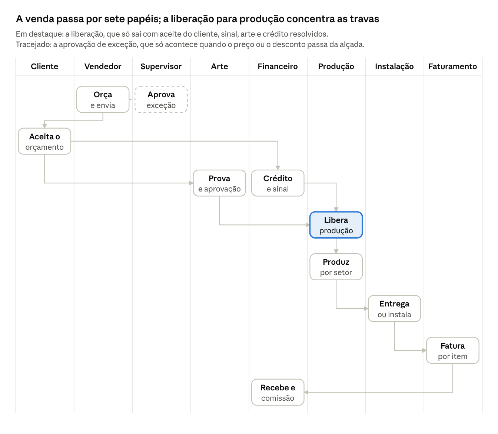

# A venda alimenta as filas de cada setor

**Data:** 2026-10-20 · **Autor:** Claude Code [L+C], a pedido do Luiz · **Tela:** [/sells/create-v3](../../../resources/js/Pages/Sells/CreateV3.charter.md)
**Escopo:** como vendas, produção, financeiro e faturamento dividem a mesma venda nos concorrentes (13 sistemas de comunicação visual e sign shop, 7 ERPs), e o que isso pede da create-v3. Só material público. Nada foi testado.

> Parte do pacote [Protótipo create-v3](README.md). Continua o [01 — casos de uso](01-casos-de-uso-nos-concorrentes.md). Notas de pesquisa em [notas/divisao-de-tarefas/](notas/divisao-de-tarefas/).

Os concorrentes não põem todo mundo para trabalhar na tela de venda: a venda é um registro único, e cada setor recebe a sua parte numa fila própria (aprovações, liberação para produção, quadro do setor, entregas, "a faturar"). Os mais completos (Sign OS, shopVOX, Nortgraf, Protheus, Sankhya) separam o aceite do cliente da liberação para produção, que só sai com sinal, arte e crédito resolvidos. O faturamento não tem lugar fixo: sign shops faturam depois de concluir ou instalar, os ERPs gerais emitem a nota antes de a mercadoria sair, e a VisualCalc fatura já na aprovação. Para a create-v3, a máquina de estados com papéis é o esqueleto certo; faltam separar "aprovada pelo cliente" de "liberada para produção", mostrar as travas com dono, tirar o "Faturar" do caminho obrigatório da entrega e esconder os valores de quem não vende.

Referência: protótipo /sells/create-v3 em 20/10/2026. Ele ainda não grava dados, e estoque e financeiro estão fechados para alteração. "(inferência)" marca uma conclusão nossa que nenhuma fonte afirma diretamente.

## Quem faz o quê em cada etapa

A lista abaixo serve para desenhar um diagrama de raias. Cada passo diz quem faz, para quem passa e que trava precisa estar resolvida. A ordem é uma síntese dos concorrentes (inferência). Nenhum sistema faz todos os passos desta forma.

**Raias**
1. Cliente (externo)
2. Vendedor
3. Supervisor / gerente comercial (aprovações)
4. Arte
5. Financeiro (crédito, sinal, recebimento, comissão)
6. PCP / Produção (setores)
7. Instalação / Expedição
8. Faturamento / Fiscal

**Passos**

1. **Orçar**
   - Raia: Vendedor.
   - Faz: itens por medida, preço, desconto, prazo, tipo de entrega por item, condição com sinal e comissão.
   - Passa para: Supervisor, só se houver exceção. Depois vai ao Cliente.
   - Trava: a exceção de preço ou de desconto precisa estar aprovada antes do envio.
     - O Sign OS pode exigir aprovação de um gerente para enviar o orçamento ([Sign OS: Approvals](https://signos.com.au/help/customers-store/approvals)).
     - No Sankhya, o vendedor escolhe quem vai liberar e recebe o resultado por aviso ([Sankhya: Liberação de Limites](https://ajuda.sankhya.com.br/hc/pt-br/articles/360044601034-Libera%C3%A7%C3%A3o-de-Limites)).
     - No Protheus, a alçada é avaliada antes do crédito e do estoque ([TOTVS: Alçadas](https://centraldeatendimento.totvs.com/hc/pt-br/articles/36573314419351-Cross-Segmentos-Backoffice-Protheus-SIGAFAT-Configura%C3%A7%C3%A3o-do-fluxo-de-Al%C3%A7adas-no-Pedido-de-Venda)).
2. **Aprovar a exceção** (só quando existe)
   - Raia: Supervisor.
   - Passa para: Vendedor. O pedido volta liberado, liberado em parte ou negado.
   - Trava: decisão registrada com quem, quando e qual valor.
     - O Sankhya tem o estado "valor liberado menor que o solicitado" ([Sankhya: Liberação de Limites](https://ajuda.sankhya.com.br/hc/pt-br/articles/360044601034-Libera%C3%A7%C3%A3o-de-Limites)).
     - No Olist, o gerente digita um código na hora e não há fila ([Olist: desconto de gerente](https://ajuda.olist.com/condicoes-comerciais/liberacao-de-desconto-para-gerente)).
3. **Aceitar o orçamento**
   - Raia: Cliente (por link) ou Vendedor (registra o aceite).
   - Passa para: Arte, Financeiro e PCP, ao mesmo tempo.
   - Trava: aceite registrado e dados mínimos preenchidos. No Sign OS, aceitar exige a data em que o cliente precisa, a data em que a produção termina e a forma de entrega. Tudo passa ao job sem redigitar ([Sign OS: Quote to job](https://signos.com.au/help/quoting/quote-to-job)).
   - **Divergência:** VisualCalc, Everflow, Ajors, Ordant e GestãoClick mandam o pedido para a produção já no aceite ([VisualCalc](https://www.visualcalc.com.br/); [Ordant: Order Approval](https://www.ordant.com/module/print-order-approval-automation/)). Sign OS, shopVOX e Nortgraf exigem um segundo ato, a liberação.
4. **Resolver as pendências** (em paralelo)
   - **4a. Crédito.**
     - Raia: Financeiro.
     - Trava: cliente sem bloqueio, ou liberação com motivo.
     - O Sign OS deixa a loja escolher entre não fazer nada, avisar ou bloquear. Para passar por cima do bloqueio, é preciso permissão e motivo ([Sign OS: Customer on hold](https://signos.com.au/help/exceptions/customer-on-hold)).
     - O Calcgraf libera ou recusa o crédito no próprio pedido ([Calcgraf: Pedido](https://www.calcgraf.com.br/solucao/pedido/)).
     - O Protheus põe o pedido na fila do analista de crédito ([TOTVS: bloqueios do pedido](https://centraldeatendimento.totvs.com/hc/pt-br/articles/360014207291-Cross-Segmentos-Backoffice-Protheus-SIGAFAT-Como-identificar-e-liberar-bloqueios-do-Pedido-de-Vendas)).
     - **Divergência:** o Omie só barra o crédito na hora de faturar ([Omie: limite de crédito](https://ajuda.omie.com.br/pt-BR/articles/1685971-definindo-limite-de-credito-para-seus-clientes)). Então o pedido pode ser produzido antes de o bloqueio aparecer (inferência). O Sankhya barra no pedido e de novo no faturamento, se a liberação tiver vencido ([Sankhya: nova liberação no faturamento](https://ajuda.sankhya.com.br/hc/pt-br/articles/360056785493-Pedido-j%C3%A1-liberado-solicitando-nova-libera%C3%A7%C3%A3o-no-faturamento-para-o-Evento-3-Limite-de-Cr%C3%A9dito)).
   - **4b. Sinal.**
     - Raias: o Cliente paga e o Financeiro confirma.
     - Trava: sinal confirmado.
     - O Sign OS mostra "aguardando sinal" e pode tirar o job do quadro até o pagamento ([Sign OS: Changelog](https://signos.com.au/changelog)).
     - A Nortgraf trava o pedido até o operador conferir o pagamento manual ([Nortgraf: Pagamentos](https://nortgraf.com/ajuda/artigo/tela-de-pagamentos-aprove-e-gerencie-recebimentos)).
     - A GestãoClick recebe o sinal na aprovação ([GestãoClick CV](https://gestaoclick.com.br/segmentos/programa-para-empresa-de-comunicacao-visual/)).
   - **4c. Arte.**
     - Raias: Arte e Cliente. O Vendedor passa o briefing e os arquivos por item.
     - Trava: prova aprovada, item por item.
     - No Sign OS, um job liberado com prova não aprovada fica esperando. "Aprovado com ajustes" não libera sozinho ([Sign OS: Artwork approvals](https://signos.com.au/help/jobs/artwork-approvals)).
     - O shopVOX recomenda que o gerente de projeto ou o vendedor revise a prova antes de ela ir ao cliente ([shopVOX: PM no proofing](https://shopvox-pro.helpdocs.io/article/j8194abdac-empowering-project-managers-in-the-proofing-process-a-guide-to-workflow-enhancement-with-shop-vox)).
     - **Divergência:** a ordem entre sinal e arte. Usuários do Signs101 exigem desenho aprovado e sinal antes de produzir ([Signs101, 2022](https://www.signs101.com/threads/how-do-you-guys-keep-track-of-orders-jobs-currently-in-your-shop.169677/page-3)). O Sign OS deixa o admin adiantar a arte enquanto o sinal não cai ([Sign OS: Changelog](https://signos.com.au/changelog)).
5. **Liberar para produção**
   - Raia: PCP / gerente de produção.
   - Passa para: os setores de produção.
   - Trava: 4a, 4b e 4c resolvidas (ou liberadas com motivo) e dados técnicos completos.
     - O Sign OS lista os jobs em "Ready to release", e só a liberação os leva ao chão. Na liberação, ele reserva o material e agenda o job a partir da data de entrega ([Sign OS: Release](https://signos.com.au/help/production/release-to-production)).
     - A Nortgraf manda conferir itens, arquivos, pagamento e prazo antes do envio para produção ([Nortgraf: Produção](https://nortgraf.com/ajuda/artigo/producao-ordens-filas-e-kanban)).
     - No shopVOX, criar o job é o mesmo que mandar para produção ([shopVOX: Where do jobs fit](https://shopvox-pro.helpdocs.io/article/yunn3w6v2p-where-do-jobs-fit-in-the-order-process-in-shop-vox)).
6. **Produzir por setor**
   - Raia: Produção.
   - Passa para: Instalação / Expedição, quando a última etapa do item termina ([Nortgraf: Produção](https://nortgraf.com/ajuda/artigo/producao-ordens-filas-e-kanban)).
   - Trava: etapas do item concluídas.
     - No Sign OS, quem aperta "Start" assume a etapa. A etapa também pode ser entregue a alguém pelo nome, com aviso ([Sign OS: Floor boards](https://signos.com.au/help/production/floor-boards)).
     - No shopVOX, cada pessoa inicia, pausa e conclui o próprio passo ([shopVOX: Workflow](https://shopvox-pro.helpdocs.io/article/0vnwpogzpx-workflow-templates-explained)).
7. **Entregar ou instalar**
   - Raia: Instalação / Expedição, com equipe própria ou terceirizada.
   - Passa para: Faturamento / Fiscal e Financeiro.
   - Trava: entrega ou instalação concluída, com comprovante (quem recebeu, fotos, checklist, assinatura).
     - A Nortgraf registra quem recebeu e o comprovante, item por item ([Nortgraf: Solicitações de entrega](https://nortgraf.com/ajuda/artigo/solicitacoes-de-entrega-expedicao-instalacao-e-comprovantes)).
     - No app da Everflow, o instalador faz check-in, tira fotos e colhe assinatura ([Everflow CV](https://everflow.com.br/segmentos/software-para-empresa-de-comunicacao-visual-erp/)).
     - O Sign OS não deixa pôr no job um instalador sem seguro válido ([Sign OS: Changelog](https://signos.com.au/changelog)).
8. **Faturar**
   - Raia: Faturamento / Fiscal. Em empresa pequena, o próprio vendedor, se tiver permissão.
   - Passa para: Financeiro (título a receber).
   - Trava: a regra de faturamento do item foi cumprida e o crédito continua válido.
     - O Sign OS tem a fila "Ready to invoice", com jobs prontos ou despachados ([Sign OS: Invoicing queue](https://signos.com.au/help/invoicing/invoicing-queue)).
     - O Omie usa a permissão "pode faturar" para separar quem vende de quem fatura ([Omie: permissões do vendedor](https://ajuda.omie.com.br/pt-BR/articles/3583365-definindo-permissoes-e-restricoes-aos-vendedores)).
   - **Principal divergência: quando faturar.**
     - **Na aprovação:** a VisualCalc emite NF-e de qualquer pedido aprovado ([VisualCalc](https://www.visualcalc.com.br/)). O CoreBridge converte o orçamento aprovado em fatura num clique ([CoreBridge](https://www.corebridge.net/)).
     - **Antes de a mercadoria sair:**
       - No Olist, "Faturado" vem antes de "Pronto para envio" ([Olist: fluxo de pedidos](https://ajuda.olist.com/pedidos/como-funciona-o-fluxo-de-pedidos-do-erp)).
       - No Protheus, primeiro se separa o material e depois se emite o documento de saída ([TOTVS: faturar](https://centraldeatendimento.totvs.com/hc/pt-br/articles/27992050172183-Cross-Segmentos-Backoffice-Protheus-SIGAFAT-Como-faturar-realizar-documentos-de-sa%C3%ADda)).
       - Hoje, a create-v3 segue este modelo.
     - **Depois de concluir, expedir ou instalar:**
       - O shopVOX fatura quando todos os jobs terminam ([shopVOX: Where do jobs fit](https://shopvox-pro.helpdocs.io/article/yunn3w6v2p-where-do-jobs-fit-in-the-order-process-in-shop-vox)).
       - O Ordant fatura quando todos os itens ficam prontos ou por romaneio, à medida que expede ([Ordant: Order Management](https://www.ordant.com/module/print-estimating-order-management/)).
       - No exemplo da GestãoClick, a NF-e da placa e a NFS-e do serviço saem na instalação ([GestãoClick CV](https://gestaoclick.com.br/segmentos/programa-para-empresa-de-comunicacao-visual/)).
     - **Por produto:** o Odoo deixa escolher entre faturar o pedido (padrão) e faturar o que foi entregue ([Odoo: Invoicing policies](https://www.odoo.com/documentation/20.0/applications/sales/sales/invoicing/invoicing_policy.html)).
9. **Receber e liberar a comissão**
   - Raia: Financeiro.
   - Passa para: Vendedor (comissão) e encerramento.
   - Trava: saldo recebido. Os sistemas discordam sobre o momento da comissão:
     - A Mubisys libera quando o cliente paga ([Mubisys Comercial](https://www.mubisys.com/comercial)).
     - A VisualCalc libera depois da entrega confirmada ([VisualCalc](https://www.visualcalc.com.br/)).
     - O Calcgraf deixa escolher entre faturado, vencimento ou liquidação, e a liberação gera o título a pagar ([Calcgraf: Comissões](https://www.calcgraf.com.br/solucao/comissoes/)).
   - Encerramento:
     - No Sign OS, só a fatura do "restante" fecha o job ([Sign OS: Raise invoice](https://signos.com.au/help/invoicing/raise-invoice)).
     - No shopVOX, o pedido fecha sozinho quando todos os jobs terminam ([shopVOX: Sales Order States](https://shopvox-pro.helpdocs.io/article/4zz9xyb5u3-sales-order-states)).

**Desvios que cruzam todas as raias**
- **Variação depois do aceite.**
  - Fluxo: o Vendedor propõe, o Supervisor aprova, e o valor revisado aparece ao lado do valor aceito.
  - O Sign OS registra a variação no job e nunca reescreve o preço aceito ([Sign OS: Job variations](https://signos.com.au/help/jobs/job-variations)).
  - O Ordant acompanha as alterações de pedido (change orders) em cada job ([Ordant: Sign Shop](https://www.ordant.com/sign-shop-software/)).
- **Em espera.**
  - Um papel autorizado pausa a venda com motivo. Nada é liberado até ela voltar.
  - Fontes: [Sign OS: Changelog](https://signos.com.au/changelog). No shopVOX, o "Hold" do pedido também segura os jobs ([shopVOX: Sales Order States](https://shopvox-pro.helpdocs.io/article/4zz9xyb5u3-sales-order-states)).
- **Balcão.**
  - O serviço feito na hora pula a liberação formal (inferência).
  - Lojistas dizem que não vão criar tarefas para um trabalho de 20 minutos ([Signs101, 2026](https://www.signs101.com/threads/looking-for-some-early-adoptors-to-help-shape-a-sign-shop-mis.183747/)).

## Como os concorrentes dividem o trabalho

Primeiro os sistemas de comunicação visual e sign shop. Depois os ERPs gerais.

| Sistema | Como a venda passa adiante | Travas entre etapas | Quem fatura e onde | Quem vê o quê |
|---|---|---|---|---|
| [Sign OS](https://signos.com.au/) (sign shop, AU) | O aceite cria o job, que espera em "Ready to release". O "Release" leva o job ao quadro do setor. O Outbound cuida de entrega e instalação. | Arte aprovada; sinal pago; crédito (nada, avisar ou bloquear); "em espera" com motivo; aprovação de gerente opcional para enviar orçamento, emitir fatura e aprovar variação | O financeiro, na fila "Ready to invoice" (pronto ou despachado). Fatura por item, só o sinal ou o restante. | Papéis prontos e mais de 70 permissões por pessoa; chão de fábrica sem preço; instalador só no portal, com os próprios jobs |
| [shopVOX](https://shopvox-pro.helpdocs.io/article/yunn3w6v2p-where-do-jobs-fit-in-the-order-process-in-shop-vox) (sign shop, EUA) | Orçamento → pedido → "Create Job", que manda para a produção. O workflow vem do produto, e cada pessoa inicia e conclui o próprio passo. | "Hold" segura os jobs; a prova aprovada faz a etapa avançar; trava de crédito ou de sinal não documentada | O pedido vira fatura quando todos os jobs terminam. Fatura parcial por linha, ativada pelo suporte. | Papéis CSR, Sales, Designer e Production; Production só vê jobs; desconto e custo da linha liberados por papel |
| [Nortgraf](https://nortgraf.com/ajuda/artigo/producao-ordens-filas-e-kanban) (gráfica e CV, BR) | Pedido → "envio para produção" manual → kanban por item → solicitações de entrega | Pagamento manual trava até o operador conferir; arte aprovada pode mudar o status; conferir o pagamento antes de produzir é só boa prática | Quem tem permissão emite pelo menu Ações do pedido, pela tela Fiscal ou pelo PDV. Se faltar dado, a nota vira rascunho. | Perfis com Ver, Criar, Editar e Excluir por módulo; um documento para cada destino (OS para a produção, romaneio para a expedição) |
| [CoreBridge](https://www.corebridge.net/production-management) (sign shop, EUA) | Orçamento aprovado → pedido. Quadros por item com movimento automático e equipes de instalação. | Prova enviada ao cliente ou aprovada internamente | O orçamento aprovado vira fatura num clique. Faturamento por etapas só no plano mais caro. | Papéis e acessos personalizáveis; a licença separa usuário padrão de usuário de produção |
| [Ordant](https://www.ordant.com/module/print-order-approval-automation/) (gráfica e sign shop, EUA) | O aceite manda cada linha sozinha para a produção. As estações mostram o próximo job. | Sinal antes de projeto grande; limite pelo histórico de crédito; regra "prova aprovada vai para a fila" | Fatura quando todos os itens terminam, ou por romaneio, ao expedir | Atendente (CSR) autorizado cria orçamento; o resto não está documentado |
| [GestãoClick](https://gestaoclick.com.br/segmentos/programa-para-empresa-de-comunicacao-visual/) (ERP com página de CV, BR) | O aprovado vira OS sem redigitar. Arte, Impressão, Acabamento e Instalação são colunas do kanban. | Sinal recebido na aprovação; cliente assina a arte pelo link | NF-e pela OS ou pela venda. NFS-e pela OS ou disparada pela situação. No exemplo, a nota sai na instalação. | Designer e instalador na mesma OS; a IA só responde o que o usuário pode ver |
| [VisualCalc](https://www.visualcalc.com.br/) (CV, BR) | O orçamento aprovado entra sozinho no kanban. Produção, financeiro e cliente são avisados. | Nenhuma documentada entre aprovação e produção | NF-e de qualquer pedido aprovado; conta a receber criada na aprovação | Permissão por perfil; registro de quem fez o quê |
| [Calcgraf](https://www.calcgraf.com.br/solucao/faturamento/) (gráfica com CV, BR) | Atendente e vendedor lançam; orçamentista e gestor supervisionam; PCP por área | Restrição automática de crédito; liberação ou recusa de crédito no pedido | Módulo Faturamento: nota por pedido, por OP ou por produto acabado, com lista de pendências | Níveis de responsabilidade; portal para vendedores |
| [Mubisys](https://ajuda.mubisys.com/) (CV, BR) | OS no menu Comercial; produção por setores e PCP | Item de menu "O.S.s com restrição" no Financeiro (sem conteúdo publicado) | Telas "Faturamento" e "Monitor de notas" no Financeiro | "Permissão de acesso" e "Log de acesso" (sem conteúdo publicado) |
| [Everflow](https://everflow.com.br/segmentos/software-para-empresa-de-comunicacao-visual-erp/) (serviços, com página de CV, BR) | O orçamento aprovado gera a OS com etapas por tipo de trabalho. Um coordenador acompanha. | Nenhuma documentada | NFS-e pela OS; a fatura sai do projeto concluído | Instalador no app (check-in, fotos, assinatura) |
| [Ajors SIGN](https://ajors.com.br/ajors-sign) (CV, BR) | OS gerada do orçamento aprovado; PCP; agenda de instalação | Aceite do cliente registrado | Módulo "Faturamento, comissões, notas e boletos" | Perfis limitam o que comercial, operação, financeiro e direção veem ([Ajors: Segurança](https://ajors.com.br/seguranca-lgpd)) |
| [Holdprint](https://www.holdprint.net/) (CV, BR) | O vendedor revisa o que foi aprovado antes do planejamento (inferência pelo texto); um alocador escolhe quem inicia cada processo | Não documentado | Não documentado | Não documentado |
| [TOTVS Protheus](https://centraldeatendimento.totvs.com/hc/pt-br/articles/360014207291-Cross-Segmentos-Backoffice-Protheus-SIGAFAT-Como-identificar-e-liberar-bloqueios-do-Pedido-de-Vendas) (ERP, BR) | Pedido → liberação → cadeia fixa: alçada, regra, crédito, estoque. Cada bloqueio vai para a fila de outra pessoa. | Alçada por valor ou por desconto; crédito opcional; estoque obrigatório; a liberação manual passa por cima das regras | O faturista, no Documento de Saída, só com os itens liberados. O título a receber nasce na nota. | Permissão por função de cada rotina; o bloqueio de crédito não aparece na lista de pedidos |
| [Sankhya](https://ajuda.sankhya.com.br/hc/pt-br/articles/360049307294-Tipos-de-Libera%C3%A7%C3%A3o-de-Limites) (ERP, BR) | Central de Vendas → liberações por evento → o Portal de Vendas fatura | Desconto, crédito, atraso, margem mínima e estoque viram pedidos de liberação; o vendedor escolhe o liberador; liberação parcial | Portal de Vendas, com cartão "Pedidos à faturar" e faturamento agrupado | Vendedor vê só os seus pedidos; alterar pedido confirmado exige duas chaves (tipo de operação e usuário); histórico de alterações |
| [Omie](https://ajuda.omie.com.br/pt-BR/articles/498882-faturando-pedidos-de-venda-em-lote) (ERP PME, BR) | Kanban de etapas; a coluna "Faturar" funciona como fila | Crédito só barra no faturamento; pedido 100% adiantado ignora o limite | Quem tem "pode faturar". Sem essa permissão, o vendedor só registra. | Vendedor vê só os seus pedidos; depois da NF, quase tudo trava |
| [Bling](https://ajuda.bling.com.br/hc/pt-br/articles/360039070654-Gerenciador-de-transi%C3%A7%C3%B5es-para-situa%C3%A7%C3%B5es-de-pedidos-de-venda) (ERP PME, BR) | Situações configuráveis, com transições que disparam ações (lançar estoque, lançar contas) | Desconto acima do limite do vendedor pede aprovação; transição não restrita por papel | Botão no pedido; a conferência da expedição pode emitir a NF | Vendedor com login próprio; cliente pode ficar restrito ao seu vendedor |
| [Olist ERP](https://ajuda.olist.com/pedidos/como-funciona-o-fluxo-de-pedidos-do-erp) (ERP PME, BR) | Situações fixas e automáticas; o pagamento confirmado abre a separação | Desconto de gerente por código, na hora; dados incompletos barram a expedição | Módulo Notas Fiscais, antes do envio | Permissões por ação; a separação fica presa ao operador, com cronômetro |
| [Conta Azul](https://ajuda.contaazul.com/hc/pt-br/articles/11069160384013-Vendas-como-alterar-a-situa%C3%A7%C3%A3o-de-negocia%C3%A7%C3%A3o) (ERP PME, BR) | Em andamento → Aprovado → Faturado, fixo | Nenhuma trava de desconto ou de crédito | O perfil Vendedor emite NF-e e NFS-e; o perfil Financeiro não acessa Vendas | Vendedor Júnior vê só os seus pedidos; Sênior vê todos |
| [Odoo](https://www.odoo.com/documentation/20.0/applications/sales/sales/invoicing/invoicing_policy.html) (ERP, referência internacional) | Cotação → pedido. Ordem de produção e separação nascem na confirmação. | Regras de aprovação antes de um botão; opção de travar o pedido confirmado | Por produto: fatura o pedido ou o entregue. O vendedor gera o rascunho e o contador valida em lote. | Só os próprios documentos ou todos; margem visível por configuração |

**Padrões**
- **Aceite do cliente não é liberação para produção.**
  - Sign OS, shopVOX, Nortgraf e Protheus têm um ato de liberação separado, com fila própria ([Sign OS: Release](https://signos.com.au/help/production/release-to-production); [TOTVS: Liberação](https://centraldeatendimento.totvs.com/hc/pt-br/articles/360029031132-Cross-Segmento-TOTVS-Backoffice-Linha-Protheus-SIGAFAT-Finalidade-da-rotina-de-Libera%C3%A7%C3%A3o-de-Pedido-de-Venda)).
  - Quem junta os dois atos (VisualCalc, Everflow, GestãoClick) deixa sinal e arte como "boa prática".
- **Cada setor trabalha na sua fila, não na tela de venda.** Quadro por departamento, quadro de jobs, solicitações de entrega, "Pedidos à faturar", liberação de limites. A venda é a fonte dos dados e mostra o status.
- **Faturamento é fila e permissão, não um degrau fixo.**
  - Sign OS, Sankhya, Omie e Calcgraf têm uma lista própria do que falta faturar.
  - A permissão "pode faturar" deixa a empresa pequena faturar pelo vendedor sem mudar a tela ([Omie](https://ajuda.omie.com.br/pt-BR/articles/3583365-definindo-permissoes-e-restricoes-aos-vendedores)).
- **Pedido aceito não se reedita.**
  - O Sign OS registra a mudança como variação e não toca no preço aceito.
  - O Odoo tem a opção "Lock Confirmed Sales" ([Odoo: Create quotations](https://www.odoo.com/documentation/20.0/applications/sales/sales/sales_quotations/create_quotations.html)).
  - O Omie trava quase tudo depois da NF ([Omie: após faturamento](https://ajuda.omie.com.br/pt-BR/articles/8238860-realizando-alteracoes-em-um-pedido-de-venda-apos-o-faturamento)).
  - O Sankhya exige duas chaves para editar pedido confirmado ([Sankhya: alteração após confirmar](https://ajuda.sankhya.com.br/hc/pt-br/articles/360043659413-Altera%C3%A7%C3%A3o-n%C3%A3o-permitida-pela-TOP-Usu%C3%A1rio)).
- **O preço some para quem não vende.**
  - O chão de fábrica do Sign OS nunca vê valores ([Sign OS: Roles](https://signos.com.au/help/your-team/roles-permissions)).
  - O papel Production do shopVOX só vê jobs. Desconto e custo da linha são liberados por papel ([shopVOX: Roles](https://shopvox-pro.helpdocs.io/article/kxjbfjtst4-setting-roles-for-your-team); [shopVOX: custo da linha](https://shopvox-pro.helpdocs.io/article/62bwr9pryt-sun-10-27-2024-role-based-permissions-for-editing-or-overriding-line-item-costs-unit-cost-pro)).
  - Nenhum sistema de CV brasileiro documenta isso publicamente.

**Força da evidência**
- **Com manual que mostra o fluxo:** Sign OS, shopVOX, Nortgraf e os ERPs.
- **Só com página de produto ou menu:** Mubisys, Holdprint, Ajors e Everflow.
- **Ressalvas:**
  - Muitos artigos do shopVOX são de cerca de 2024.
  - O Sign OS é de 2026 e tem poucos clientes.
  - "Não documentado" quer dizer que não achamos, não que o sistema não faz.

## Na tela de venda

| Papel | O que vê | O que pode mudar | Ação que passa adiante |
|---|---|---|---|
| Vendedor | A venda inteira, com preço, desconto, condição e a própria comissão. Painel de travas com dono. Custo e margem só com permissão. | Tudo até o aceite: itens, preço dentro da alçada, prazo, entrega, condição e observações. Depois do aceite, só propõe variação. | "Enviar orçamento", "Registrar aceite do cliente", "Pedir liberação" (desconto, preço, crédito), "Propor variação" |
| Supervisor / gerente | Tudo, inclusive custo, margem e o motivo de cada pedido de liberação | Aprova ou nega exceções: desconto, preço abaixo de 85%, crédito e variação. Reabre e cancela. | "Aprovar exceção", "Liberar crédito com motivo", "Aprovar variação", "Reabrir para correção", "Cancelar" |
| Arte | Itens que pedem arte, com briefing, arquivos, observação para a arte e prazo. Sem valores (inferência). | Versões da prova e status da arte de cada item | "Enviar prova", "Registrar aprovação da arte" (aprovada com ajustes não libera) |
| Produção (PCP e setores) | Itens com medidas, material, acabamento, etapas, prazos, observação para a produção e travas. Sem preço. | Datas, responsáveis e status das etapas. Não mexe em preço nem em quantidade. | "Liberar para produção" (PCP), "Concluir etapa", "Concluir produção" |
| Instalação / expedição | Itens a entregar ou instalar, com endereço da obra, contato, data e observação para a instalação. Sem preço. | Data marcada, equipe, comprovante (quem recebeu, fotos, assinatura) e entrega parcial | "Registrar entrega/instalação", por item |
| Financeiro | Valores, condição, sinal, comissão, e crédito e atraso do cliente (lidos do financeiro) | Confirma o sinal e libera ou bloqueia o crédito. No protótipo, só a trava muda. | "Confirmar sinal", "Liberar crédito" e, depois, "Liberar comissão" |
| Faturamento / fiscal | Itens a faturar, natureza (produto ou serviço), dados fiscais, sinal já recebido e o que já foi faturado | Dados fiscais antes de emitir. Não mexe em preço. | "Faturar", por item ou tudo (NF-e e NFS-e) |

**Princípios**
1. **Um registro para todos.** A venda é a fonte, e cada papel vê uma fatia do mesmo dado. No Sign OS, a produção lê os números que o vendedor digitou ([Sign OS](https://signos.com.au/)). A etapa diz onde a venda está, e as travas dizem por que ela parou. São dois eixos diferentes. A Nortgraf separa o status do pedido do status do pagamento ([Nortgraf: Status de pedidos](https://nortgraf.com/ajuda/artigo/status-de-pedidos-configuracao-e-automacoes)). No Protheus, o bloqueio de crédito some da lista de pedidos, e isso é o erro a evitar ([TOTVS: botão rejeitar](https://centraldeatendimento.totvs.com/hc/pt-br/articles/1500009773842-Cross-Segmento-TOTVS-Backoffice-Linha-Protheus-Sigafat-Usabilidade-do-bot%C3%A3o-rejeitar-na-an%C3%A1lise-de-cr%C3%A9dito)).
2. **A tela é do vendedor, e os outros papéis agem por ações com nome.** Hoje, cada papel age na própria venda por ações com nome que já checam o papel. Depois, cada um ganha a sua fila. A tela sempre mostra com quem a venda está e desde quando, como o liberador nomeado do Sankhya e o operador com cronômetro do Olist ([Olist: lock na separação](https://ajuda.olist.com/separacao-de-produtos/bloqueio-de-pedidos-lock-na-separacao)).
3. **O que trava, e quando.**
   - Preço e itens travam no aceite.
   - Os dados de produção travam na liberação, item por item. O Protheus trava só os itens que já estão em separação ([TOTVS: pedido com separação](https://centraldeatendimento.totvs.com/hc/pt-br/articles/360026401614-Cross-Segmentos-BackOffice-Protheus-SIGAFAT-Altera%C3%A7%C3%A3o-e-estorno-de-Pedido-de-Venda-liberado-que-cont%C3%A9m-Ordem-de-Separa%C3%A7%C3%A3o)).
   - O que já foi faturado não se edita. A correção é com cancelamento ou nota de crédito ([Sign OS: Raise invoice](https://signos.com.au/help/invoicing/raise-invoice)).
4. **Mudança depois do aceite é variação.**
   - O valor aceito fica intacto, e a variação aprovada aparece ao lado.
   - "Reabrir" serve para corrigir erro. Só o gerente reabre, sempre com motivo, e as aprovações voltam a zero.
   - No Sign OS, só o admin reabre ([Sign OS: Reopen](https://signos.com.au/help/exceptions/reopen-job)). No Protheus, quem quer reabrir estorna a liberação para o aprovador decidir de novo ([TOTVS: Alçadas](https://centraldeatendimento.totvs.com/hc/pt-br/articles/36573314419351-Cross-Segmentos-Backoffice-Protheus-SIGAFAT-Configura%C3%A7%C3%A3o-do-fluxo-de-Al%C3%A7adas-no-Pedido-de-Venda)).

## O que já dá para aplicar no protótipo

**Máquina de estados: hoje e proposta.** A proposta é inferência, a partir de Sign OS, shopVOX, Nortgraf e Odoo. Os nomes de papel novos são só sugestão.

| Hoje | Proposta |
|---|---|
| Rascunho → "Finalizar venda" (vendas.criar) → Orçamento | Rascunho → "Enviar orçamento" (vendas.criar; trava: exceções aprovadas) → Orçamento |
| Orçamento → "Aprovar orçamento" (vendas.aprovar) → Aprovada | Orçamento → "Registrar aceite do cliente" (vendas.criar; trava: datas e entrega preenchidas) → Aprovada pelo cliente. Preço e itens travam aqui. |
| Aprovada → "Iniciar produção" (producao.iniciar; ReservarEstoque) → Em produção | Aprovada → "Liberar para produção" (producao.liberar; ReservarEstoque; trava: painel verde ou liberação com motivo) → Em produção |
| Em produção → "Faturar" (financeiro.faturar; ConsumirEstoque, BaixarFinanceiro) → Faturada | Em produção → "Concluir produção" → Pronta para entrega |
| Faturada → "Entregar" (expedicao.entregar) → Entregue | Pronta → "Registrar entrega/instalação" (expedicao.entregar; comprovante) → Entregue |
| Entregue → "Encerrar" (vendas.encerrar) | Entregue → "Encerrar" (vendas.encerrar; trava: tudo faturado e recebido) |
| — | Trilhas paralelas: Faturamento (a faturar, parcial, faturado), Sinal, Arte por item, Crédito, Variação, Em espera |

**Checklist** (em ordem de valor e esforço)

- [ ] **Separar aceite e liberação.** "Aprovar orçamento" vira "Registrar aceite do cliente". Entra o estado "Aguardando liberação". "Iniciar produção" vira "Liberar para produção" (producao.liberar), com ReservarEstoque. — *agora (dentro da tela)* — Base: [Sign OS](https://signos.com.au/help/production/release-to-production), [shopVOX](https://shopvox-pro.helpdocs.io/article/yunn3w6v2p-where-do-jobs-fit-in-the-order-process-in-shop-vox), [Nortgraf](https://nortgraf.com/ajuda/artigo/producao-ordens-filas-e-kanban).
- [ ] **Painel "Travas para liberar".** Aceite, sinal, arte por item, crédito e dados técnicos, cada um com estado, dono e desde quando. Quem tem permissão libera com trava vermelha, mas o motivo vai para o histórico. — *agora (dentro da tela)* — Base: [Sign OS](https://signos.com.au/help/exceptions/customer-on-hold), [Nortgraf](https://nortgraf.com/ajuda/artigo/status-de-pedidos-configuracao-e-automacoes), [Protheus](https://centraldeatendimento.totvs.com/hc/pt-br/articles/360000659308-Cross-Segmentos-BackOffice-Protheus-SIGAFAT-Restri%C3%A7%C3%A3o-de-Libera%C3%A7%C3%A3o-Manual-de-Pedidos-para-evitar-Estoque-Negativo) (negar a liberação manual a quem não deve).
- [ ] **Dados obrigatórios no aceite.** "Cliente precisa até", "produção termina até" e tipo de entrega por item (retirada, entrega ou instalação com endereço). — *agora (dentro da tela)* — Base: [Sign OS](https://signos.com.au/help/quoting/quote-to-job).
- [ ] **Visão sem valores.** Arte, produção e instalação abrem a venda sem preço, desconto, comissão e condição. Custo e margem só com permissão. — *agora (dentro da tela)* — Base: [Sign OS](https://signos.com.au/help/your-team/roles-permissions), [shopVOX](https://shopvox-pro.helpdocs.io/article/kxjbfjtst4-setting-roles-for-your-team).
- [ ] **Trava de sinal.** A condição de pagamento marca a parcela de sinal (% ou R$). Entra o estado "aguardando sinal" e a ação "Confirmar sinal", do financeiro. No protótipo, essa ação só muda a trava. — *agora (dentro da tela)* — Base: [Sign OS](https://signos.com.au/changelog), [Nortgraf](https://nortgraf.com/ajuda/artigo/pagamento-parcial-sinal-e-saldo-restante), [GestãoClick](https://gestaoclick.com.br/segmentos/programa-para-empresa-de-comunicacao-visual/).
- [ ] **Trava de arte por item.** Marca "requer arte aprovada", status da prova (aguardando, aprovada, aprovada com ajustes, recusada) e ação "Registrar aprovação da arte", do papel arte. "Com ajustes" não libera. — *agora (dentro da tela)* — Base: [Sign OS](https://signos.com.au/help/jobs/artwork-approvals), [shopVOX](https://shopvox-pro.helpdocs.io/article/1b28ummawc-uploading-and-sending-proofs-for-approval), [Nortgraf](https://nortgraf.com/ajuda/artigo/modulo-de-criacao-de-artes-do-briefing-a-aprovacao).
- [ ] **Faturar sai do caminho da entrega.** "Entregar" deixa de exigir "Faturada". O faturamento vira trilha por item, com uma regra por item: no aceite, antes de sair ou depois da entrega/instalação. Quem fatura: financeiro.faturar, ou o vendedor com "pode faturar". — *agora (dentro da tela)* — Base: [Odoo](https://www.odoo.com/documentation/20.0/applications/sales/sales/invoicing/invoicing_policy.html), [Olist](https://ajuda.olist.com/pedidos/como-funciona-o-fluxo-de-pedidos-do-erp), [Sign OS](https://signos.com.au/help/invoicing/invoicing-queue), [Omie](https://ajuda.omie.com.br/pt-BR/articles/3583365-definindo-permissoes-e-restricoes-aos-vendedores). A regra fiscal para mercadoria em trânsito precisa ser confirmada com o contador.
- [ ] **Preço trava no aceite, e mudança vira variação.** Hoje a trava começa em "Em produção". Ela passa para o aceite. Entram "Propor variação" e "Aprovar variação", com o valor aceito e o revisado lado a lado. — *agora (dentro da tela)* — Base: [Sign OS](https://signos.com.au/help/jobs/job-variations), [Odoo](https://www.odoo.com/documentation/20.0/applications/sales/sales/sales_quotations/create_quotations.html), [Conta Azul](https://ajuda.contaazul.com/hc/pt-br/articles/11069160384013-Vendas-como-alterar-a-situa%C3%A7%C3%A3o-de-negocia%C3%A7%C3%A3o).
- [ ] **Exceção vira pedido de liberação.** O alerta de 85% e o desconto acima da alçada viram um pedido com aprovador nomeado e estado (pendente, liberado, liberado em parte, negado). O pedido bloqueia "Enviar orçamento" e some sozinho se o vendedor corrigir. — *agora (dentro da tela)* — Base: [Sankhya](https://ajuda.sankhya.com.br/hc/pt-br/articles/360049307294-Tipos-de-Libera%C3%A7%C3%A3o-de-Limites), [Sign OS](https://signos.com.au/help/customers-store/approvals).
- [ ] **Crédito como trava.** Ler do financeiro o limite e o atraso do cliente, só leitura. A regra escolhe entre nada, avisar ou bloquear. A liberação tem motivo e vale por alguns dias. — *agora (dentro da tela, com leitura)* — Base: [Sign OS](https://signos.com.au/help/exceptions/customer-on-hold), [Calcgraf](https://www.calcgraf.com.br/solucao/pedido/), [Sankhya](https://ajuda.sankhya.com.br/hc/pt-br/articles/360056785493-Pedido-j%C3%A1-liberado-solicitando-nova-libera%C3%A7%C3%A3o-no-faturamento-para-o-Evento-3-Limite-de-Cr%C3%A9dito) (validade da liberação).
- [ ] **"Com quem está" no topo.** Mostrar o dono do próximo passo e há quanto tempo ele está com a venda, tirado do histórico. Exemplo: "Aguardando arte · Maria · há 2 dias". — *agora (dentro da tela)* — Base: [Olist](https://ajuda.olist.com/separacao-de-produtos/bloqueio-de-pedidos-lock-na-separacao), [Sankhya](https://ajuda.sankhya.com.br/hc/pt-br/articles/360044601034-Libera%C3%A7%C3%A3o-de-Limites).
- [ ] **Reabrir com regra.** Só o gerente reabre, e sempre com motivo. A venda volta para Orçamento e perde o aceite e as aprovações. Depois de faturada, não reabre. — *agora (dentro da tela)* — Base: [Sign OS](https://signos.com.au/help/exceptions/reopen-job), [Protheus](https://centraldeatendimento.totvs.com/hc/pt-br/articles/36573314419351-Cross-Segmentos-Backoffice-Protheus-SIGAFAT-Configura%C3%A7%C3%A3o-do-fluxo-de-Al%C3%A7adas-no-Pedido-de-Venda), [Conta Azul](https://ajuda.contaazul.com/hc/pt-br/articles/11069160384013-Vendas-como-alterar-a-situa%C3%A7%C3%A3o-de-negocia%C3%A7%C3%A3o).
- [ ] **Rever os efeitos declarados.**
  - ReservarEstoque vai para a liberação.
  - ConsumirEstoque vai para a etapa que a empresa escolher.
  - O faturamento gera a conta a receber, e a baixa só acontece no recebimento.
  - Falta confirmar o que BaixarFinanceiro faz hoje.

  — *agora (só a declaração)* — Base: [Calcgraf](https://www.calcgraf.com.br/solucao/orcamento/) (reserva o material depois da OP), [GestãoClick](https://gestaoclick.com.br/segmentos/programa-para-empresa-de-comunicacao-visual/) (a empresa escolhe a etapa), [Protheus](https://centraldeatendimento.totvs.com/hc/pt-br/articles/1500005473302-Crosss-Segmentos-TOTVS-Backoffice-Linha-Protheus-SIGAFAT-Nota-sobre-gera%C3%A7%C3%A3o-de-t%C3%ADtulo-atrav%C3%A9s-do-pedido-de-venda) (o título nasce na nota).
- [ ] **Comissão com regra de liberação.** A venda mostra quando a comissão fica devida (faturamento, entrega ou recebimento) e o estado dela: prevista, liberável ou liberada. — *agora (só exibição)* — Base: [Mubisys](https://www.mubisys.com/comercial), [VisualCalc](https://www.visualcalc.com.br/), [Calcgraf](https://www.calcgraf.com.br/solucao/comissoes/).
- [ ] **Em espera e encerramento.** Entra a ação "Colocar em espera", com motivo, que bloqueia a liberação. "Encerrar" só com tudo entregue, faturado e recebido. — *agora (dentro da tela)* — Base: [Sign OS](https://signos.com.au/changelog), [shopVOX](https://shopvox-pro.helpdocs.io/article/4zz9xyb5u3-sales-order-states).
- [ ] **Observações por destino.** Às observações interna e para a produção, somar "para a arte" e "para a instalação". — *agora (dentro da tela)* — Base: [shopVOX](https://shopvox-pro.helpdocs.io/article/avhotlqqzj-transactions-new-quote).
- [ ] **Caixa de aprovações.** Uma fila do supervisor, e o vendedor recebe aviso do resultado. — *depois (ligação com outros módulos)* — Base: [Sign OS](https://signos.com.au/help/customers-store/approvals), [Sankhya](https://ajuda.sankhya.com.br/hc/pt-br/articles/360044601034-Libera%C3%A7%C3%A3o-de-Limites).
- [ ] **Quadro por setor.** As etapas do item viram a fila de cada setor, sem preço. "Iniciar" e "Concluir" num toque, e a etapa pode ser entregue a alguém pelo nome. — *depois (ligação com outros módulos)* — Base: [Sign OS](https://signos.com.au/help/production/floor-boards), [shopVOX](https://shopvox-pro.helpdocs.io/article/0vnwpogzpx-workflow-templates-explained), [Signs101](https://www.signs101.com/threads/how-do-you-guys-keep-track-of-orders-jobs-currently-in-your-shop.169677/page-3) (o chão de fábrica só quer apertar um botão).
- [ ] **Fila "A faturar".** NF-e e NFS-e por item, fatura parcial e agrupada, e sinal rateado entre os itens. — *depois (ligação com outros módulos)* — Base: [Sign OS](https://signos.com.au/help/invoicing/deposit-part-payment), [Sankhya](https://ajuda.sankhya.com.br/hc/pt-br/articles/360043882094-Cart%C3%A3o-de-Pedidos-%C3%A0-faturar), [Calcgraf](https://www.calcgraf.com.br/solucao/faturamento/).
- [ ] **Link do cliente.** O aceite do orçamento e da arte por link resolve a trava sozinho. — *depois (ligação com outros módulos)* — Base: [shopVOX](https://shopvox-pro.helpdocs.io/article/ffdzllzkww-quote-states), [GestãoClick](https://gestaoclick.com.br/segmentos/programa-para-empresa-de-comunicacao-visual/).
- [ ] **Sinal e recebimento de verdade.** O pagamento lido do financeiro abre a trava do sinal e libera a comissão, que gera um título a pagar. — *depois (ligação com outros módulos)* — Base: [Nortgraf](https://nortgraf.com/ajuda/artigo/tela-de-pagamentos-aprove-e-gerencie-recebimentos), [Calcgraf](https://www.calcgraf.com.br/solucao/comissoes/).
- [ ] **Portal ou app do instalador.** O instalador vê só os próprios jobs, com endereço e notas. Fotos e assinatura voltam para a venda. — *depois (ligação com outros módulos)* — Base: [Sign OS](https://signos.com.au/help/purchasing/installer-portal), [shopVOX Go](https://shopvox-pro.helpdocs.io/article/q43khmwvlw-shop-vox-go-app), [Everflow](https://everflow.com.br/segmentos/software-para-empresa-de-comunicacao-visual-erp/).

## Fontes

**Sign shop, exterior**
- https://signos.com.au/
- https://signos.com.au/help/your-team/roles-permissions
- https://signos.com.au/help/customers-store/approvals
- https://signos.com.au/help/exceptions/customer-on-hold
- https://signos.com.au/help/jobs/job-variations
- https://signos.com.au/help/quoting/quote-to-job
- https://signos.com.au/help/production/release-to-production
- https://signos.com.au/help/production/floor-boards
- https://signos.com.au/help/jobs/artwork-approvals
- https://signos.com.au/help/purchasing/installer-portal
- https://signos.com.au/help/invoicing/invoicing-queue
- https://signos.com.au/help/invoicing/raise-invoice
- https://signos.com.au/help/invoicing/deposit-part-payment
- https://signos.com.au/help/exceptions/reopen-job
- https://signos.com.au/changelog
- https://shopvox-pro.helpdocs.io/article/kxjbfjtst4-setting-roles-for-your-team
- https://shopvox-pro.helpdocs.io/article/62bwr9pryt-sun-10-27-2024-role-based-permissions-for-editing-or-overriding-line-item-costs-unit-cost-pro
- https://shopvox-pro.helpdocs.io/article/yunn3w6v2p-where-do-jobs-fit-in-the-order-process-in-shop-vox
- https://shopvox-pro.helpdocs.io/article/j8194abdac-empowering-project-managers-in-the-proofing-process-a-guide-to-workflow-enhancement-with-shop-vox
- https://shopvox-pro.helpdocs.io/article/0vnwpogzpx-workflow-templates-explained
- https://shopvox-pro.helpdocs.io/article/4zz9xyb5u3-sales-order-states
- https://shopvox-pro.helpdocs.io/article/ffdzllzkww-quote-states
- https://shopvox-pro.helpdocs.io/article/1b28ummawc-uploading-and-sending-proofs-for-approval
- https://shopvox-pro.helpdocs.io/article/avhotlqqzj-transactions-new-quote
- https://shopvox-pro.helpdocs.io/article/q43khmwvlw-shop-vox-go-app
- https://shopvox-pro.helpdocs.io/article/xgzelxopko-how-to-create-partial-invoices
- https://www.corebridge.net/
- https://www.corebridge.net/production-management
- https://www.corebridge.net/estimating-intelligence
- https://www.corebridge.net/pricing
- https://www.ordant.com/module/best-print-estimating-software/
- https://www.ordant.com/module/print-order-approval-automation/
- https://www.ordant.com/module/shop-floor-data-collection/
- https://www.ordant.com/module/print-estimating-order-management/
- https://www.ordant.com/sign-shop-software/

**Comunicação visual, Brasil**
- https://nortgraf.com/ajuda/artigo/producao-ordens-filas-e-kanban
- https://nortgraf.com/ajuda/artigo/tela-de-pagamentos-aprove-e-gerencie-recebimentos
- https://nortgraf.com/ajuda/artigo/status-de-pedidos-configuracao-e-automacoes
- https://nortgraf.com/ajuda/artigo/modulo-de-criacao-de-artes-do-briefing-a-aprovacao
- https://nortgraf.com/ajuda/artigo/solicitacoes-de-entrega-expedicao-instalacao-e-comprovantes
- https://nortgraf.com/ajuda/artigo/pagamento-parcial-sinal-e-saldo-restante
- https://nortgraf.com/ajuda/artigo/emitindo-nf-e-e-nfs-e
- https://nortgraf.com/ajuda/artigo/perfis-de-acesso-controle-de-permissoes
- https://nortgraf.com/ajuda/artigo/pedidos-historico-documentos-e-impressao
- https://gestaoclick.com.br/segmentos/programa-para-empresa-de-comunicacao-visual/
- https://www.visualcalc.com.br/
- https://www.calcgraf.com.br/solucao/orcamento/
- https://www.calcgraf.com.br/solucao/pedido/
- https://www.calcgraf.com.br/solucao/faturamento/
- https://www.calcgraf.com.br/solucao/comissoes/
- https://www.calcgraf.com.br/solucao/pcp/
- https://www.mubisys.com/comercial
- https://ajuda.mubisys.com/
- https://everflow.com.br/segmentos/software-para-empresa-de-comunicacao-visual-erp/
- https://ajors.com.br/ajors-sign
- https://ajors.com.br/seguranca-lgpd
- https://www.holdprint.net/

**Usuários**
- https://www.signs101.com/threads/how-do-you-guys-keep-track-of-orders-jobs-currently-in-your-shop.169677/page-3
- https://www.signs101.com/threads/looking-for-some-early-adoptors-to-help-shape-a-sign-shop-mis.183747/

**ERPs gerais**
- https://centraldeatendimento.totvs.com/hc/pt-br/articles/360014207291-Cross-Segmentos-Backoffice-Protheus-SIGAFAT-Como-identificar-e-liberar-bloqueios-do-Pedido-de-Vendas
- https://centraldeatendimento.totvs.com/hc/pt-br/articles/360029031132-Cross-Segmento-TOTVS-Backoffice-Linha-Protheus-SIGAFAT-Finalidade-da-rotina-de-Libera%C3%A7%C3%A3o-de-Pedido-de-Venda
- https://centraldeatendimento.totvs.com/hc/pt-br/articles/36573314419351-Cross-Segmentos-Backoffice-Protheus-SIGAFAT-Configura%C3%A7%C3%A3o-do-fluxo-de-Al%C3%A7adas-no-Pedido-de-Venda
- https://centraldeatendimento.totvs.com/hc/pt-br/articles/1500009773842-Cross-Segmento-TOTVS-Backoffice-Linha-Protheus-Sigafat-Usabilidade-do-bot%C3%A3o-rejeitar-na-an%C3%A1lise-de-cr%C3%A9dito
- https://centraldeatendimento.totvs.com/hc/pt-br/articles/360000659308-Cross-Segmentos-BackOffice-Protheus-SIGAFAT-Restri%C3%A7%C3%A3o-de-Libera%C3%A7%C3%A3o-Manual-de-Pedidos-para-evitar-Estoque-Negativo
- https://centraldeatendimento.totvs.com/hc/pt-br/articles/27992050172183-Cross-Segmentos-Backoffice-Protheus-SIGAFAT-Como-faturar-realizar-documentos-de-sa%C3%ADda
- https://centraldeatendimento.totvs.com/hc/pt-br/articles/1500005473302-Crosss-Segmentos-TOTVS-Backoffice-Linha-Protheus-SIGAFAT-Nota-sobre-gera%C3%A7%C3%A3o-de-t%C3%ADtulo-atrav%C3%A9s-do-pedido-de-venda
- https://centraldeatendimento.totvs.com/hc/pt-br/articles/360026401614-Cross-Segmentos-BackOffice-Protheus-SIGAFAT-Altera%C3%A7%C3%A3o-e-estorno-de-Pedido-de-Venda-liberado-que-cont%C3%A9m-Ordem-de-Separa%C3%A7%C3%A3o
- https://ajuda.sankhya.com.br/hc/pt-br/articles/360044601034-Libera%C3%A7%C3%A3o-de-Limites
- https://ajuda.sankhya.com.br/hc/pt-br/articles/360049307294-Tipos-de-Libera%C3%A7%C3%A3o-de-Limites
- https://ajuda.sankhya.com.br/hc/pt-br/articles/360056785493-Pedido-j%C3%A1-liberado-solicitando-nova-libera%C3%A7%C3%A3o-no-faturamento-para-o-Evento-3-Limite-de-Cr%C3%A9dito
- https://ajuda.sankhya.com.br/hc/pt-br/articles/360043882094-Cart%C3%A3o-de-Pedidos-%C3%A0-faturar
- https://ajuda.sankhya.com.br/hc/pt-br/articles/360043659413-Altera%C3%A7%C3%A3o-n%C3%A3o-permitida-pela-TOP-Usu%C3%A1rio
- https://ajuda.sankhya.com.br/hc/pt-br/articles/360045109773-Altera%C3%A7%C3%A3o-de-Pedidos-Parcialmente-Faturados
- https://ajuda.sankhya.com.br/hc/pt-br/articles/18617361830935-Como-realizar-o-faturamento-agrupado-de-pedidos
- https://ajuda.sankhya.com.br/hc/pt-br/articles/33798492218647-Usu%C3%A1rio-logado-com-restri%C3%A7%C3%A3o-de-vendedor-Verifique-na-tela-de-Usu%C3%A1rios-na-aba-Seguran%C3%A7a-no-campo-Ver-Pedidos-Notas-WEB
- https://ajuda.omie.com.br/pt-BR/articles/2199357-configurando-as-etapas-do-kanban-de-vendas
- https://ajuda.omie.com.br/pt-BR/articles/498882-faturando-pedidos-de-venda-em-lote
- https://ajuda.omie.com.br/pt-BR/articles/3583365-definindo-permissoes-e-restricoes-aos-vendedores
- https://ajuda.omie.com.br/pt-BR/articles/1685971-definindo-limite-de-credito-para-seus-clientes
- https://ajuda.omie.com.br/pt-BR/articles/8238860-realizando-alteracoes-em-um-pedido-de-venda-apos-o-faturamento
- https://ajuda.bling.com.br/hc/pt-br/articles/360039070654-Gerenciador-de-transi%C3%A7%C3%B5es-para-situa%C3%A7%C3%B5es-de-pedidos-de-venda
- https://ajuda.bling.com.br/hc/pt-br/articles/360035444474-Cadastrar-vendedores
- https://ajuda.bling.com.br/hc/pt-br/articles/24112035701143-Como-configurar-automa%C3%A7%C3%B5es-do-checkout-de-pedidos-de-venda
- https://ajuda.bling.com.br/hc/pt-br/articles/7061310911895-Vincular-contato-a-um-vendedor
- https://ajuda.olist.com/pedidos/como-funciona-o-fluxo-de-pedidos-do-erp
- https://ajuda.olist.com/condicoes-comerciais/liberacao-de-desconto-para-gerente
- https://ajuda.olist.com/separacao-de-produtos/bloqueio-de-pedidos-lock-na-separacao
- https://ajuda.olist.com/expedicao/expedicao-utilizacao
- https://ajuda.contaazul.com/hc/pt-br/articles/11069160384013-Vendas-como-alterar-a-situa%C3%A7%C3%A3o-de-negocia%C3%A7%C3%A3o
- https://ajuda.contaazul.com/hc/pt-br/articles/45771599988237-Dados-de-acesso-quais-perfis-de-acesso-existem-e-como-escolher
- https://www.odoo.com/documentation/20.0/applications/sales/sales/invoicing/invoicing_policy.html
- https://www.odoo.com/documentation/20.0/applications/sales/sales/sales_quotations/create_quotations.html
- https://www.odoo.com/documentation/20.0/applications/studio/approval_rules.html
- https://www.odoo.com/documentation/20.0/applications/finance/accounting/customer_invoices/overview.html
- https://www.odoo.com/documentation/20.0/applications/inventory_and_mrp/inventory/warehouses_storage/replenishment/mto.html
- https://www.odoo.com/documentation/20.0/applications/general/users/access_rights.html
- https://www.odoo.com/documentation/20.0/applications/sales/sales/sales_quotations/margin.html
